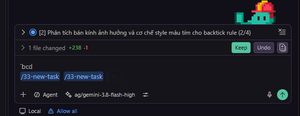
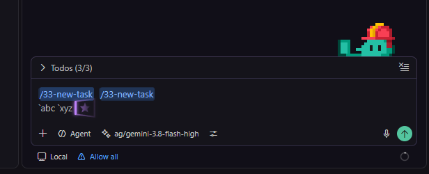
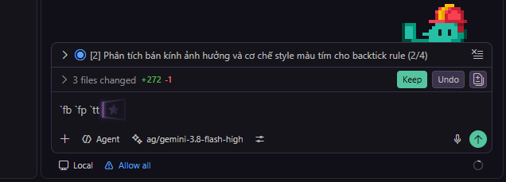
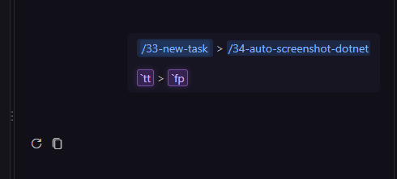

# JARVIS IDE Enhancer

**Bespoke Luxury Visuals & Intelligent Prompt Engineering for VS Code**

[](package.json)
[](LICENSE)
[](https://code.visualstudio.com/)
[](#-zero-crash-architecture)

Craft an elite, high-performance workspace for Founders & Developers: 3D Isometric Neon Cursor, signature JARVIS Copilot Chat placeholder with Vietnamese flags, seamless mid-prompt Slash Command Intellisense, and automated zero-crash styling synchronization.

---

## 🌟 Overview

**JARVIS IDE Enhancer** elevates VS Code and GitHub Copilot Chat into an exquisite, high-efficiency development cockpit:

- **Elite Aesthetics:** Soft-glowing 3D Isometric cursor with GPU-accelerated central vector star and elegant national-flag-accented JARVIS placeholder.
- **Accelerated Interaction:** Unlock mid-prompt Slash Command suggestions, visually distinguishing built-in system workflows (Blue Pills) from custom founder macros (Purple Pills).
- **End-to-End Visual Consistency:** Uniform styling across Monaco input editors, queued prompts, chat history bubbles, and inline request editors.
- **Zero-Crash Resilience & Multi-Device Sync:** Safe, non-destructive file operations with V8 AST pre-compilation validation, fully integrated with GitHub Settings Sync across all workstations.

---

## 🚀 Core Features

### 1. 3D Isometric Glowing Cursor & JARVIS Chat Placeholder

- **3D Isometric Neon Cursor:** Smooth `#c084fc` rounded caret with soft ambient bloom, paired with an isometric 3D spatial window housing a central vector star optimized via GPU-accelerated SVG. Unobtrusive to text selection and mouse dragging.
- **JARVIS Ready Chat Placeholder:** When the Copilot chat input is empty, the generic prompt is replaced with a centered, distinguished `JARVIS READY FOR COMMAND` banner accented with Vietnamese national flags. Automatically vanishes instantly on the first keystroke with zero cursor jump.



---

### 2. Multi-Prompt Slash Command Intellisense (Blue Pills)

- **Mid-Prompt Slash Suggestions:** Bypass VS Code's restriction that only allows slash commands at the very beginning of a prompt. Trigger intellisense for `/workflow`, `/rule`, `/skill` anywhere after spaces, `>`, colons, or semicolons.
- **Slash Command Blue Pills:** Every slash command token is automatically enclosed in an elegant blue pill badge (`#89b4fa` / `rgba(38, 71, 120, 0.4)`), offering instant visual structure for chained, multi-step workflows.



---

### 3. Custom Backtick Macro Highlighting (Purple Pills)

- **Founder Shortcut Highlighting:** Automatically detects and styles user-defined macro abbreviations (e.g., `` `fp ``, `` `tt ``, `` `wtn ``, `` `rp ``, `` `git ``) with a signature purple glow (`#d8b4fe`, border `rgba(192, 132, 252, 0.45)`, shadow `rgba(168, 85, 247, 0.25)`).
- **Intelligent Tokenizer:** Powered by RegExp Negative Lookahead to ensure standard Markdown inline code blocks (`` `inline code` ``) remain untouched without unwanted styling.



---

### 4. Interactive Backtick Macro Autocomplete Popup

- **Floating Suggestion Widget:** As soon as you type a backtick (`` ` ``) followed by prefix characters (e.g., `` `fp ``, `` `tt ``, `` `rcm ``) in the Chat Input editor, an interactive suggestion popup appears directly above the cursor.
- **Keyboard Navigation & Instant Insertion:** Seamlessly navigate suggestions via `ArrowUp` and `ArrowDown`, accept with `Enter` or `Tab`, and dismiss with `Escape`. Selected macros insert atomic tokens instantly with exact trailing space.
- **Rich Macro Metadata:** Displays macro key, human-readable labels, and full descriptions for all 20+ founder macro commands.

---

### 5. Full Lifecycle Consistency (Chat Input, History & Inline Edit)

- **Uniform Lifecycle Styling:** Blue pill styling for Slash Commands and purple pills for Backtick Macros persist across the Monaco Input Editor, queued requests, chat history bubbles, and inline edit sessions.
- **Markdown Backtick Restorer:** Eliminates common Markdown parser issues that strip leading backticks, faithfully rendering exact prompt tokens in conversation bubbles.
- **High-Performance DOM Processing:** Utilizes `MutationObserver` paired with `TreeWalker` targeting text nodes directly (< 0.1ms latency, zero UI jank).



---

### 6. Centered Chat Tables & Streamlined Markdown

- **Centered Data Tables:** Automatically aligns Markdown tables within Copilot Chat responses (`margin: 0 auto; display: table`), transforming technical reports and data matrices into clean dashboards.
- **Decluttered Prompt Formatting:** Strips redundant gray code borders in user prompt bubbles for a modern, sleek appearance.
- **Smooth Continuous Progress Spinner:** Input border animation runs seamlessly during AI generation via `@property --chat-input-anim-angle`, unaffected by OS-level Reduce Motion settings.

---

### 7. Cloud Settings Sync (Multi-Device)

- **Cloud-Backed Personalization:** Extend and customize CSS and JS directly through configuration keys:
  - `jarvisEnhancer.customCSS`: Append or override bespoke CSS rules.
  - `jarvisEnhancer.customJS`: Append or override custom UI scripts.
- **Automatic GitHub Settings Sync:** Settings persist in VS Code `settings.json`, syncing across all developer workstations (desktops, laptops, remote servers) upon GitHub login.
- **Instant Silent Synchronization:** The extension silently mirrors configuration changes into local disk assets (`~/.jarvis/style/`) in real-time.

---

### 8. Automated Self-Healing Patch Daemon

- **Zero-Friction VS Code Update Recovery:** VS Code updates often wipe custom file injections in `workbench.desktop.main.js` and `workbench.html`. The Self-Healing Daemon silently inspects patch integrity upon extension startup.
- **Non-Blocking Background Repair:** Runs with debounced delays to ensure zero impact on editor startup performance, auto-reapplying patches and notifying you with a 1-click Reload prompt.
- **Configurable Daemon Lifecycle:** Easily toggled via `jarvisEnhancer.enableSelfHealing` in VS Code settings.

---

### 9. Macro Auto-Discovery & Settings Sync Engine

- **Automatic Rule Harvesting:** Scans and extracts custom founder macro abbreviations directly from `.instructions.md` rule files across user profiles, global prompts, and open workspaces.
- **GitHub Settings Sync Integration:** Discovered macros are stored in `jarvisEnhancer.customMacros` and automatically synchronized across all machines via GitHub Settings Sync.
- **Live Rule File Watcher:** File watchers observe `.instructions.md` changes and dynamically update macro autocomplete popup registries in real time.

---

### 10. Zero-FOUC Empty Terminal Suppression

- **Hybrid CSS & JS Guard:** Completely eliminates empty rectangular tool/terminal execution boxes in GitHub Copilot Chat when commands run silently without output (e.g. `node --check` or silent scripts).
- **Zero-FOUC (Flash of Unstyled Content):** Leverages Chromium native CSS `:has()` rules to suppress empty execution containers instantaneously without visual jitter.
- **ANSI Escape & Whitespace Sanitization:** Intelligent JS DOM observer strips xterm escape sequences (`\u001b`) and whitespace to reliably distinguish truly silent commands from active logs, preserving 100% visibility for commands with real stdout/stderr and standard Markdown code blocks.

---

## 🛠️ Setup & Usage

### Prerequisites

Install the official stylesheet loader: [Custom CSS and JS Loader](https://marketplace.visualstudio.com/items?itemName=be5invis.vscode-custom-css) (`be5invis.vscode-custom-css`).

### Quick Start

1. **Install Extension:** Install `JARVIS IDE Enhancer` from the VS Code Marketplace or from a packaged `.vsix` file.
2. **Synchronize & Apply Styles:**
   - Open Command Palette (`Ctrl+Shift+P` on Windows/Linux or `Cmd+Shift+P` on macOS).
   - Run: `JARVIS: Sync Setup & Apply Styles`.
   - Assets extract to `~/.jarvis/style/`, register in `vscode_custom_css.imports`, and trigger the style loader.
3. **Unlock Slash Command Intellisense (Recommended):**
   - Run: `JARVIS: Patch Chat Slash Intellisense`.
   - Safe patching completes in under 0.2s with automatic `.bak` backup.
4. **Reload Window:**
   - Click `Reload Window` when prompted to enjoy your upgraded workspace.

---

## ⌨️ Available Commands

| Command Title (Command Palette) | Command ID | Description |
|:---|:---|:---|
| `JARVIS: Sync Setup & Apply Styles` | `jarvisEnhancer.syncSetup` | Extracts assets to `~/.jarvis/style/`, updates `settings.json`, and triggers automatic style reload. |
| `JARVIS: Discover Macros & Sync Settings` | `jarvisEnhancer.discoverMacros` | Scans `.instructions.md` rule files, extracts custom macro abbreviations, and syncs them to global settings and cloud sync. |
| `JARVIS: Patch Chat Slash Intellisense` | `jarvisEnhancer.patchIntellisense` | Safely patches VS Code bundle with V8 AST syntax verification to enable mid-prompt slash suggestions and Monaco hooks. |
| `JARVIS: Edit Custom CSS` | `jarvisEnhancer.editCSS` | Directly opens `~/.jarvis/style/vscode-custom.css` in editor for live styling adjustments. |
| `JARVIS: Edit Custom JS` | `jarvisEnhancer.editJS` | Directly opens `~/.jarvis/style/vscode-custom.js` in editor for UI script enhancements. |
| `JARVIS: Run Self-Healing & Verify Patches` | `jarvisEnhancer.runSelfHealing` | Inspects and automatically repairs workbench patches and styling injections if missing after VS Code updates. |

---

## 📂 File Structure

```text
~/.jarvis/style/
├── vscode-custom.css    # Bundled CSS stylesheets: 3D cursor, placeholder, and pill badges
└── vscode-custom.js     # Bundled JS client bridge: Monaco hook, tokenizer, and history observer
```

Extension repository structure:
```text
ide-style-studio/
├── assets/
│   ├── icon.png                 # Official JARVIS IDE Enhancer icon
│   ├── vscode-custom.css        # Packaged source CSS
│   └── vscode-custom.js         # Packaged source JS
├── docs/
│   └── images/                  # High-resolution feature documentation screenshots
├── extension.js                 # Primary extension controller managing sync and safe patching
└── package.json                 # Extension manifest declaring commands, settings, and metadata
```

---

## 🛡️ Zero-Crash Architecture

`JARVIS IDE Enhancer` is engineered with defensive design principles:

1. **Process Isolation:**
   - The Extension Host runs in an isolated Node.js worker, never injecting unverified code directly into the renderer DOM.
   - Styling injection is delegated to the proven architecture of `be5invis.vscode-custom-css`.
2. **Non-Destructive Backups:**
   - Prior to modifying core bundle files (`workbench.desktop.main.js`), an exact `.bak` snapshot is automatically generated.
3. **Pre-Write V8 AST Syntax Verification:**
   - All patched payloads must pass AST compilation via Node.js `vm.Script`. If any syntax error or corrupt structure is detected, file writes abort immediately, eliminating black screens or broken installations.
4. **Resource Guarding & Anti-Leak Safeguards:**
   - Observers (`MutationObserver`, `TreeWalker`) employ guard flags (`__historyDecorated`) and targeted scope selectors, ensuring zero memory leaks and negligible CPU overhead.

---

## 📄 License

Licensed under the [MIT License](LICENSE). Free for personal and commercial development.


