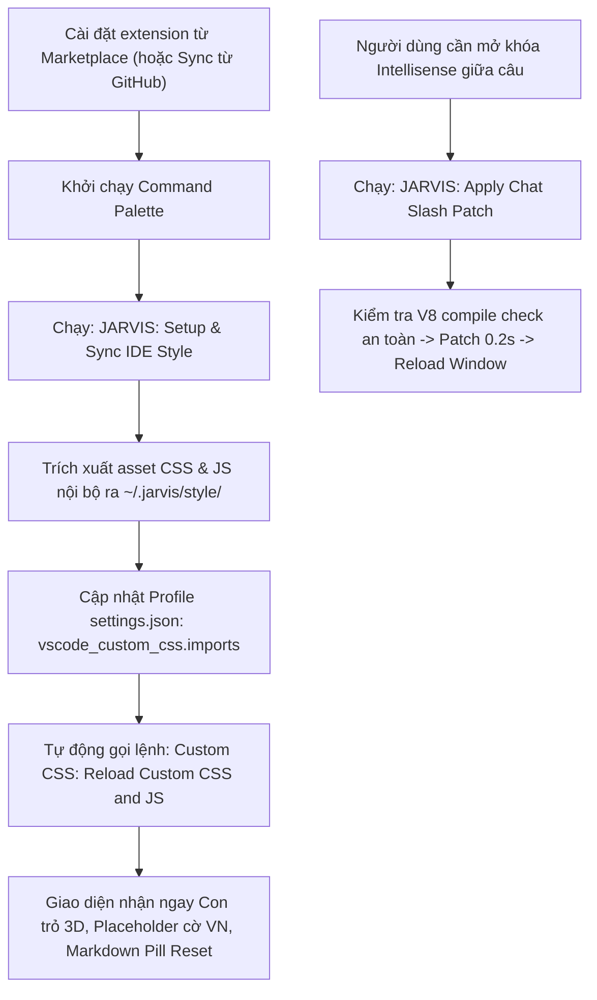

# TASK PLAN: REFACTOR & PUBLISH JARVIS IDE ENHANCER (OPTION 1 + B)

## 0. Metadata

| Field | Value |
|:---|:---|
| **Task ID** | `TASK-20261007-001` |
| **Ngày tạo** | 2026-10-07 |
| **Người tạo** | JARVIS |
| **Priority** | 🟠 High |
| **Effort** | M (1-4h) |
| **Status** | 📋 Planning |
| **Branch** | `feature/jarvis-ide-enhancer-marketplace` |
| **Lifecycle** | `Ready` |
| **Evidence** | `Confirmed` |
| **Plan structure** | Single-file |
| **Project root** | `C:\Users\mes\projects\ide-style-studio` |
| **Plan path** | `planning/tasks/20261007_jarvis_ide_enhancer_marketplace/TASK_JARVIS_IDE_ENHANCER_MARKETPLACE.md` |
| **Change intent key** | `refactor-and-publish-jarvis-ide-enhancer-marketplace` |

---

## 1. Mục tiêu & giá trị

- **Mục tiêu:** Tái cấu trúc (refactor) dự án `ide-style-studio` thành extension chuẩn Marketplace `jarvis-ide-enhancer` (hoặc `minhtalent-dev.jarvis-ide-enhancer`), loại bỏ mã nguồn styling webview cũ, đóng gói trực tiếp các asset CSS/JS nội bộ (Con trỏ 3D, Placeholder JARVIS cờ VN, Spinner viền, Markdown pill reset, Bôi xanh slash command pill sau `>`), tự động cấu hình Settings & User Task.
- **Giá trị:** 
  1. Cho phép publish lên VS Code Marketplace để tự động đồng bộ (Settings Sync via GitHub) trên mọi thiết bị làm việc của FOUNDER mà không cần copy file thủ công.
  2. Cách ly 100% rủi ro crash màn hình đen (Zero-Risk Architecture), tách biệt giữa Extension Node.js Runtime và DOM Injection.

---

## 2. Phạm vi

- **In scope:**
  - Dọn dẹp mã cũ: xóa `groups.js`, `webview.js`.
  - Tổ chức thư mục `assets/` chứa bản chuẩn của `vscode-custom.css` và `vscode-custom.js`.
  - Cập nhật manifest `package.json`: định danh publisher (`minhtalent-dev` hoặc `jarvis`), repository git, icon, keywords, categories, commands (`jarvisEnhancer.syncSetup`, `jarvisEnhancer.patchIntellisense`).
  - Xây dựng controller `extension.js`:
    + Lệnh `jarvisEnhancer.syncSetup`: Tự động sao chép assets vào thư mục người dùng cố định (`~/.jarvis/style/`), tự động inject đường dẫn vào `vscode_custom_css.imports` của Profile hiện hành, tự động kiểm tra kích hoạt các settings Chat liên quan.
    + Lệnh `jarvisEnhancer.patchIntellisense`: Thực thi patch an toàn có V8 compile check cho `workbench.desktop.main.js` (không chạy ngầm lúc startup).
  - Đóng gói `.vsix` và script/hướng dẫn publish lên Visual Studio Marketplace bằng `vsce publish`.
- **Out of scope:**
  - Không thay đổi các rule CSS/JS đang hiển thị ổn định (giữ nguyên pixel-perfect 100%).
  - Không tự động ghi đè bundle ngầm khi mở cửa sổ mới (`onStartupFinished` không ghi file nhị phân).
- **Affected users/environments:** Môi trường VS Code cá nhân và các máy trạm đồng bộ qua GitHub Settings Sync của FOUNDER.
- **Data/contracts unchanged:** Cấu trúc theme màu `Aura Dark` và các profile settings khác giữ nguyên vẹn.

---

## 3. Hiện trạng / Nguyên lý / Assumptions / Constraints

- **Confirmed (Đã xác minh):**
  - Extension `be5invis.vscode-custom-css` đã cài đặt và quản lý việc inject HTML an toàn.
  - File `D:\2_Other\vscode-custom.css` và `D:\2_Other\vscode-custom.js` đang vận hành đúng nghiệp vụ hiển thị mong muốn.
  - VS Code Settings Sync chỉ sync các extension có ID hợp lệ trên Visual Studio Marketplace.
  - Publisher `minhtalent-dev` đã từng publish extension (`9router-monitor-pro`) nên đã có sẵn tài khoản Marketplace / Azure DevOps PAT.
- **Assumptions:**
  - FOUNDER sẽ dùng `vsce publish` kèm Personal Access Token (PAT) để phát hành bản 0.1.0/1.0.0 lên Marketplace.
- **Constraints:**
  - Bắt buộc tuân thủ Zero-Crash Contract: Extension Host Node.js không được ghi đè bundle lúc mở cửa sổ để tránh xung đột đa tiến trình.

---

## 4. File Impact & Ma trận Bán kính Ảnh hưởng (Blast Radius Matrix)

| Tầng | Thành phần | Chi tiết tác động |
|:---|:---|:---|
| **1. Target (Sửa chính)** | `C:\Users\mes\projects\ide-style-studio\` | - `package.json`: Cập nhật name, displayName, publisher, repository, commands, assets. - `extension.js`: Viết mới controller Sync Setup & Safe Core Patch. - `assets/vscode-custom.css`: Đóng gói asset CSS. - `assets/vscode-custom.js`: Đóng gói asset JS. - Xóa: `groups.js`, `webview.js`. |
| **2. Upstream Callers** | Command Palette & Settings Sync | Đăng ký các command mới: `jarvisEnhancer.syncSetup`, `jarvisEnhancer.patchIntellisense`. |
| **3. Downstream Dependents** | Profile Settings & Custom CSS Loader | Tự động ghi vào `settings.json` của Profile active: `vscode_custom_css.imports`. |
| **4. Side-Effects / State** | File Bundle VS Code & Settings Sync Cloud | - Bảo vệ file `workbench.desktop.main.js` qua sao lưu `.bak` và V8 Syntax Verification trước khi ghi. - Settings Sync tải extension từ Marketplace và áp dụng tự động. |

---

## 5. Luồng xử lý (Architecture Flow)

---

## 6. Phases & Tasks

### Phase 1: Dọn dẹp & Tổ chức Cấu trúc Dự án
- [ ] **Task 1.1:** Xóa bỏ `groups.js` và `webview.js` khỏi dự án `ide-style-studio`.
- [ ] **Task 1.2:** Tạo thư mục `assets/`, sao chép nội dung chuẩn của `vscode-custom.css` và `vscode-custom.js` vào thư mục này.
- [ ] **Task 1.3:** Tạo icon chính thức `assets/icon.png` (128x128) đại diện cho JARVIS IDE Enhancer.

### Phase 2: Refactor `package.json` Chuẩn Marketplace
- [ ] **Task 2.1:** Cập nhật manifest:
  - `name`: `jarvis-ide-enhancer`
  - `displayName`: `JARVIS IDE Enhancer`
  - `publisher`: `minhtalent-dev`
  - `version`: `1.0.0`
  - `description`: `Enhance VS Code with JARVIS 3D cursor, chat styles, prompt slash intellisense, and UI automation.`
  - `categories`: `["Themes", "Other"]`
  - `icon`: `assets/icon.png`
  - `repository`: Cấu hình GitHub repo tương ứng.
- [ ] **Task 2.2:** Khai báo đóng góp lệnh (commands):
  - `jarvisEnhancer.syncSetup` (Title: `JARVIS: Sync Setup & Apply Styles`)
  - `jarvisEnhancer.patchIntellisense` (Title: `JARVIS: Patch Chat Slash Intellisense`)

### Phase 3: Viết mới Controller `extension.js`
- [ ] **Task 3.1:** Viết hàm `syncSetup()`:
  - Tự động tạo thư mục người dùng an toàn: `%USERPROFILE%/.jarvis/style/`.
  - Sao chép `vscode-custom.css` và `vscode-custom.js` từ asset của extension ra thư mục trên.
  - Cập nhật cấu hình `vscode_custom_css.imports` trong `settings.json` trỏ tới 2 file trên (dùng file URI hợp lệ).
  - Tự động kích hoạt command `extension.updateCustomCSS` của extension `be5invis.vscode-custom-css`.
- [ ] **Task 3.2:** Viết hàm `patchIntellisense()`:
  - Định vị `workbench.desktop.main.js` qua `vscode.env.appRoot`.
  - Tự động sao lưu `.bak` nếu chưa có.
  - Áp dụng patch `Tme` và `Decoration` an toàn bọc try-catch.
  - Chạy `vm.Script` kiểm tra cú pháp trước khi ghi file thật.
  - Hiển thị nút `Reload Window` để áp dụng ngay.

### Phase 4: Kiểm thử, Đóng gói VSIX & Hướng dẫn Publish
- [ ] **Task 4.1:** Kiểm tra cú pháp toàn bộ dự án qua `node --check`.
- [ ] **Task 4.2:** Đóng gói bản cài đặt chính thức bằng `@vscode/vsce package`.
- [ ] **Task 4.3:** Viết tài liệu `README.md` và hướng dẫn publish 1-click bằng `npx vsce publish -p <PAT>`.

---

## 7. Test Strategy + Mapping AC

| Test Case | Mục tiêu kiểm tra | Kết quả mong đợi | Mapping AC |
|:---|:---|:---|:---|
| **TC-01** | Kiểm tra cấu trúc thư mục sạch | Không còn file `groups.js`, `webview.js` cũ | AC-1 |
| **TC-02** | Chạy lệnh Sync Setup | Asset CSS/JS được xuất ra `~/.jarvis/style/`, settings được cấu hình đúng | AC-2 |
| **TC-03** | Chạy lệnh Patch Intellisense | Bundle được patch chính xác, V8 verify 100%, không bị lỗi màn hình đen | AC-3 |
| **TC-04** | Đóng gói VSIX | `vsce package` thành công không lỗi manifest | AC-4 |

---

## 8. Risks / Rollback

- **Rủi ro:** Lỗi cấp quyền ghi file `workbench.desktop.main.js` nếu VS Code cài trong Program Files.
  - **Giảm thiểu:** VS Code của FOUNDER cài đặt ở `AppData\Local\Programs\Microsoft VS Code` (User scope), toàn quyền ghi, zero permission issue.
- **Rollback:**
  - Khôi phục file bundle: `Copy-Item workbench.desktop.main.js.bak workbench.desktop.main.js -Force`.
  - Gỡ extension: `code --uninstall-extension minhtalent-dev.jarvis-ide-enhancer`.

---

## 9. Acceptance Criteria (AC)

- **AC-1:** Dự án `ide-style-studio` được tái cấu trúc sạch sẽ, loại bỏ toàn bộ code webview cũ.
- **AC-2:** File CSS và JS được đóng gói nội bộ, hỗ trợ 1-click sync sang mọi máy qua lệnh `JARVIS: Sync Setup`.
- **AC-3:** Lệnh `JARVIS: Patch Chat Slash Intellisense` chạy độc lập, có kiểm tra cú pháp V8, tuyệt đối không gây lỗi màn hình đen.
- **AC-4:** Đóng gói file `.vsix` chuẩn Marketplace, sẵn sàng cho lệnh `vsce publish` với publisher `minhtalent-dev`.

---

## 10. Definition of Ready / Definition of Done

- **DoR:** Đã khảo sát đầy đủ hiện trạng tài nguyên CSS/JS và thông tin publisher `minhtalent-dev`.
- **DoD:**
  - [ ] Mã nguồn dự án mới biên dịch hợp lệ 0 lỗi syntax.
  - [ ] Đóng gói thành công file `.vsix` chuẩn Marketplace.
  - [ ] Cài đặt thử nghiệm và kiểm chứng hoạt động trơn tru trên VS Code hiện tại.
  - [ ] Có đầy đủ tài liệu README.md và lệnh publish.
