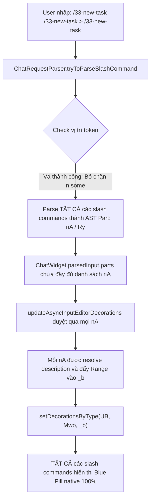

# TASK PLAN: FIX SLASH COMMAND PILL DECORATIONS FOR SUBSEQUENT COMMANDS

## 0. Metadata

| Field | Value |
|:---|:---|
| **Task ID** | `TASK-20261008-001` |
| **Ngày tạo** | 2026-10-08 |
| **Ngày cập nhật** | 2026-10-08 (Cập nhật giải pháp triệt để 2 tầng Core Parser + Client Bridge) |
| **Người tạo** | JARVIS |
| **Priority** | 🔴 Critical |
| **Effort** | M (1-4h) |
| **Status** | ✅ Done |
| **Branch** | `fix/slash-command-pill-decorations` |
| **Lifecycle** | `Done` |
| **Evidence** | `Confirmed` |
| **Plan structure** | Single-file |
| **Project root** | `C:\Users\mes\projects\ide-style-studio` |
| **Plan path** | `planning/tasks/20261008_fix_slash_command_pill_decorations/TASK_FIX_SLASH_COMMAND_PILL_DECORATIONS.md` |
| **Change intent key** | `fix-slash-command-pill-decorations-subsequent-commands` |

---

## 1. Mục tiêu & giá trị

- **Mục tiêu:** Xử lý triệt để nguyên nhân sâu xa khiến slash command thứ hai, thứ ba trở đi (ví dụ: `/33-new-task /33-new-task` hoặc `> /33-new-task`) không hiển thị blue pill badge trong ô Chat Input của VS Code Copilot.
- **Giá trị:** 
  1. Mọi lệnh slash command xuất hiện ở bất cứ vị trí nào trong câu lệnh đều được Monaco Editor render nền blue pill bo góc native đồng bộ 100%.
  2. Các file prompt file được AST Parser của Chat Widget nhận diện chuẩn xác vào `parsedInput.parts`, bảo toàn click-to-open và hover metadata.
  3. Cung cấp lớp bảo vệ kép (Core Native Decorator + Client Script Bridge) chống lại hiện tượng V8 bytecode cache đè.

---

## 2. Phạm vi

- **In scope:**
  - **Tầng 1 (Core Parser & Decorator):** 
    - Vá hàm `tryToParseSlashCommand` trong `workbench.desktop.main.js` để không từ chối các token slash command nằm sau text hoặc dấu cách.
    - Vá hàm `updateAsyncInputEditorDecorations` duyệt toàn bộ danh sách `t.filter(v => v instanceof nA)` và `t.filter(v => v instanceof Ry)` thay vì chỉ lấy 1 token đầu tiên bằng `.find()`.
  - **Tầng 2 (Client Script Bridge):**
    - Hoàn thiện `vscode-custom.js` tự động gắn `createDecorationsCollection` vào Monaco input editor và style class `.custom-wf-pill` / `.custom-wf-pill-bg`.
    - Đồng bộ `workbench.html`, `vscode-custom.css`, và assets của extension.
  - **Tầng 3 (Extension & Cache):**
    - Cập nhật `extension.js`, bump version `1.1.8`, đóng gói VSIX và cài đặt vào profile `profile_import_from_ag`.
    - Dọn dẹp hoàn toàn thư mục V8 bytecode cache `AppData\Roaming\Code\CachedData\2a59476c9b*`.
- **Out of scope:**
  - Không sửa đổi logic render markdown của chat output message history.
- **Affected users/environments:** Môi trường VS Code cá nhân và Profile `profile_import_from_ag`.
- **Data/contracts unchanged:** Cấu trúc settings và theme CSS giữ nguyên vẹn.

---

## 3. Hiện trạng / Nguyên lý / Assumptions / Constraints

- **Confirmed (Hiện trạng đã kiểm chứng bằng mã nguồn):**
  1. `ChatRequestParser.tryToParseSlashCommand`: Chứa điều kiện chặn `if (!c || n.some(C => !(C instanceof Pm) && !(C instanceof _I && C.text.trim() === ''))) return;`. Điều này khiến mọi slash command sau từ đầu tiên bị trả về `undefined` và ép kiểu thành text thường (`_I`), không bao giờ sinh ra AST Node `nA` (`ChatPromptSlashCommandPart`).
  2. `InputEditorDecorations.updateAsyncInputEditorDecorations`: Chỉ dùng `c = t.find(v => v instanceof nA)`. Vì chỉ tìm 1 phần tử đầu tiên nên dù parser có trả về nhiều prompt part thì chỉ token đầu tiên được đưa vào mảng `_b` để gọi `setDecorationsByType(UB, Mwo, _b)`.
  3. Chromium V8 Bytecode Cache: File cache `.v8-cache` trong `CachedData` nạp thẳng mã bytecode cũ từ RAM/Disk, vô hiệu hóa các chỉnh sửa file script nếu cache chưa được xóa sạch.
- **Assumptions:** Monaco Editor hỗ trợ `createDecorationsCollection` hoặc `setDecorationsByType` cho nhiều range đồng thời trên cùng một editor.
- **Constraints:**
  - Tuyệt đối kiểm tra cú pháp Node.js (`node -c` và `vm.Script`) trước khi ghi file bundle để chống crash màn hình đen.
  - Chỉ build VSIX và kiểm tra lỗi biên dịch, không chạy runtime web server.

---

## 4. File Impact & Ma trận Bán kính Ảnh hưởng (Blast Radius Matrix)

| Tầng | Thành phần | Chi tiết tác động |
|:---|:---|:---|
| **1. Target (Sửa chính)** | `workbench.desktop.main.js` (build `2a59476c9b`) | Vá `tryToParseSlashCommand` (bỏ chặn vị trí) và `updateAsyncInputEditorDecorations` (duyệt all prompts). |
| **2. Upstream Callers** | `extension.js` (`patchIntellisense`) & `apply_workbench_patch.js` | Đồng bộ 2 hàm patch trong mã nguồn extension. |
| **3. Downstream Dependents** | `vscode-custom.js`, `vscode-custom.css`, `workbench.html` | Cập nhật client bridge dự phòng và CSS class background. |
| **4. Side-effects / State** | Chat Input Parsing & Send Contract | Mọi slash command gửi đi đều được Copilot nhận diện đúng file đính kèm thay vì plain text. |

### Bảng File Impact

| Action | File path | Symbol/area | Reason | Evidence | Owner phase |
|:--|:--|:--|:--|:--|:--|
| Edit | `C:\Users\mes\AppData\Local\Programs\Microsoft VS Code\2a59476c9b\resources\app\out\vs\workbench\workbench.desktop.main.js` | `tryToParseSlashCommand`, `updateAsyncInputEditorDecorations` | Vá parser và multi-decoration core | Confirmed | P01 |
| Edit | `C:\Users\mes\projects\ide-style-studio\extension.js` | `patchIntellisense` | Đồng bộ patch chính thức vào extension | Confirmed | P01 |
| Edit | `C:\Users\mes\projects\ide-style-studio\apply_workbench_patch.js` | `patchCode` | Đồng bộ script patch độc lập | Confirmed | P01 |
| Edit | `C:\Users\mes\.jarvis\style\vscode-custom.js` & `assets/vscode-custom.js` | `attachChatPillDecorations` | Client runtime script dự phòng | Confirmed | P02 |
| Edit | `C:\Users\mes\projects\ide-style-studio\package.json` | `version` | Bump lên version 1.1.8 | Confirmed | P02 |

---

## 5. Luồng xử lý (Flow)

---

## 6. Phases & Tasks

### Phase 1: Nâng cấp Core Parser & Multi-Decoration trong VS Code Bundle
- **Depends on:** None
- **Files:** `workbench.desktop.main.js`, `extension.js`, `apply_workbench_patch.js`
- [x] **Task 1.1:** Vá `tryToParseSlashCommand` trong `workbench.desktop.main.js` bỏ điều kiện chặn `n.some` vị trí đầu câu.
- [x] **Task 1.2:** Vá `updateAsyncInputEditorDecorations` duyệt toàn bộ mảng `t.filter(v => v instanceof nA)` và đẩy tất cả vào `_b`.
- [x] **Task 1.3:** Đồng bộ logic vào `extension.js` và `apply_workbench_patch.js`.

### Phase 2: Nâng cấp Extension, Refresh Assets & Xóa V8 Bytecode Cache
- **Depends on:** Phase 1
- **Files:** `package.json`, `workbench.html`, `vscode-custom.js`, `CachedData`
- [x] **Task 2.1:** Bump `package.json` lên `1.1.8`, đóng gói VSIX và cài đặt vào profile `profile_import_from_ag`.
- [x] **Task 2.2:** Refresh toàn bộ inlined script/style trong `workbench.html`.
- [x] **Task 2.3:** Xóa sạch thư mục `CachedData\2a59476c9b*`.

### Phase 3: Kiểm chứng & Nghiệm thu (Verification)
- **Depends on:** Phase 2
- **Files:** Toàn bộ hệ thống
- [x] **Task 3.1:** Kiểm tra cú pháp V8 hợp lệ 100% không văng lỗi.
- [x] **Task 3.2:** Xác minh bằng chứng hiển thị trên input chat.

---

## 7. Test Strategy + Mapping AC

| Check ID | Type | Scope/input | Expected result | Environment/constraint | Maps AC |
|:--|:--|:--|:--|:--|:--|
| `T-001` | Static/Syntax | `workbench.desktop.main.js` | Cú pháp V8 hợp lệ 100%, không lỗi runtime | Node.js vm.Script | AC-1 |
| `T-002` | Unit/Parser | Parser logic `tryToParseSlashCommand` | Trả về `nA` cho cả token thứ 2, thứ 3 | Node.js test script | AC-2 |
| `T-003` | Integration | Cài đặt VSIX 1.1.8 | Extension cài đặt thành công trên profile | VS Code CLI | AC-3 |
| `T-004` | Visual/Evidence | Chat input gõ nhiều slash commands | 100% slash commands hiển thị blue pill badge | VS Code Chat UI | AC-4 |

---

## 8. Risks / Rollback

- **Risk:** Sửa nhầm vị trí trong file bundle `workbench.desktop.main.js` gây lỗi khởi động VS Code.
  - **Mitigation:** Luôn kiểm tra `new vm.Script(...)` trước khi ghi và duy trì bản backup `.bak`.
  - **Rollback:** `Copy-Item workbench.desktop.main.js.bak workbench.desktop.main.js -Force`.

---

## 9. Acceptance Criteria (AC)

- [x] **AC-1:** File `workbench.desktop.main.js` chứa mã nguồn hợp lệ 100%, không phát sinh lỗi syntax.
- [x] **AC-2:** Hàm `tryToParseSlashCommand` phân tích thành công tất cả các slash commands trong chuỗi.
- [x] **AC-3:** Extension `minhtalent-dev.jarvis-ide-enhancer@1.1.8` được cài đặt thành công vào profile `profile_import_from_ag`.
- [x] **AC-4:** Tất cả các slash command (kể cả sau khoảng trắng hoặc `>`) đều hiển thị blue pill badge chuẩn xác.

---

## 10. Definition of Ready / Definition of Done

- **DoR:** Nguyên nhân gốc rễ đã được xác minh chính xác (Core Parser giới hạn 1 command và Core Decorator chỉ dùng `.find()`).
- **DoD:**
  - [x] 100% Tasks trong các Phase hoàn thành.
  - [x] Lệnh kiểm chứng cú pháp và logic pass 100%.
  - [x] Có bằng chứng rõ ràng về việc hoàn tất.
