# Task Plan: Triển Khai JARVIS Hybrid Vault Manager — Đóng Gói & Đồng Bộ Toàn Diện Agent Customizations An Toàn Tuyệt Đối

## 0. Metadata

| Field | Value |
|:---|:---|
| **Task ID** | `TASK-20261011-003` |
| **Ngày tạo** | 2026-10-11 |
| **Người tạo** | JARVIS |
| **Priority** | 🔴 Critical |
| **Effort** | M (1-4h) |
| **Status** | ✅ Done |
| **Branch** | `feature/agent-customizations-hybrid-vault-sync` |
| **Lifecycle** | `Done` |
| **Evidence** | `Confirmed` |
| **Plan structure** | Single-file |
| **Project root** | `c:\Users\mes\projects\ide-style-studio` |
| **Plan path** | `planning/tasks/20261011_agent_customizations_hybrid_vault_sync/TASK_AGENT_CUSTOMIZATIONS_HYBRID_VAULT_SYNC.md` |
| **Change intent key** | `agent-customizations-hybrid-vault-sync` |

---

## 1. Mục tiêu & giá trị

- **Mục tiêu:** Xây dựng module **JARVIS Hybrid Vault Manager** tích hợp trực tiếp vào extension `jarvis-ide-enhancer`, cho phép xuất (Export) và nhập (Import/Restore) toàn bộ hệ sinh thái Agent Customizations:
  1. **13 MCP Servers:** `mcp.json`, cấu hình `settings.json`.
  2. **36 Skills:** `~/.agents/skills/` (34), `~/.copilot/skills/` (1), `~/.claude/skills/` (1).
  3. **6 Prompts & Instructions:** `MY_RULE`, `CALL CUSTOM AGENT`, `CREATE TASK RULE`, `Explore`, `Reviewer`, `Worker`.
  4. **5 Custom Model Providers:** `chatLanguageModels.json` (Codex, Antigravity, Gemini, Opencode, Custom).
  5. **Styles & Macros:** `~/.jarvis/style/` (`vscode-custom-macros.json`, `vscode-custom.css`, `vscode-custom.js`).
- **Giá trị:** 
  - Khắc phục triệt để hiện tượng GitHub Settings Sync bỏ sót Skills, Prompts, Models và gãy SecretStorage khi chuyển máy.
  - Bảo vệ an toàn tuyệt đối thông tin nhạy cảm: Tự động phát hiện và bóc tách mật khẩu DB, API Key, Private Tunnel URL; hỗ trợ đóng gói mã hóa chuẩn quân sự **AES-256-GCM** với Master Passphrase.
  - Chuẩn hóa đường dẫn Virtual Path (`${userHome}`, `${mcpStorage}`), hoạt động xuyên suốt trên mọi hệ điều hành (Windows, macOS, Linux).

---

## 2. Phạm vi

- **In scope:**
  - Xây dựng module `src/sync/vaultCrypto.js`: Mã hóa/giải mã AES-256-GCM + scrypt KDF + Gzip nén dữ liệu.
  - Xây dựng module `src/sync/vaultSanitizer.js`: Regex scanner bóc tách/phục hồi mật khẩu DB, API Keys, Private Tunnels, chuẩn hóa đường dẫn `${userHome}`.
  - Xây dựng module `src/sync/vaultManager.js`: Bộ điều phối quét 5 phân hệ, đóng gói thành file nhị phân `.jarvis-vault` hoặc thư mục template `.json`.
  - Tích hợp 2 lệnh mới vào `extension.js` và `package.json`:
    + `JARVIS: Export Agent Customizations Vault` (`jarvisEnhancer.exportVault`)
    + `JARVIS: Import Agent Customizations Vault` (`jarvisEnhancer.importVault`)
  - Tự động nạp API Keys vào `context.secrets` (VS Code SecretStorage/Keytar) và re-bind token model `${input:...}` trên máy đích.
- **Out of scope:**
  - Không xây dựng cloud server riêng ngoài (dùng file `.jarvis-vault` hoặc Git repository riêng tư của user).
  - Không sao chép các file nhị phân quá lớn (> 50MB, ví dụ node runtime hay chrome browser binary).
- **Affected users/environments:** Mọi máy trạm cài đặt `jarvis-ide-enhancer` cần đồng bộ môi trường Copilot & Agent.
- **Data/contracts unchanged:** Giữ nguyên 100% cấu trúc tệp gốc trên đĩa sau khi giải nén phục hồi.

---

## 3. Hiện trạng / Nguyên lý / Assumptions / Constraints

- **Confirmed:**
  - Hệ thống đang có 36 skills (`C:\Users\mes\.agents\skills\`, `~/.copilot\skills\`, `~/.claude\skills\`).
  - Profile `-7cf60fbb` chứa `mcp.json`, `chatLanguageModels.json`, `prompts/`.
  - VS Code Extension API hỗ trợ đầy đủ `context.secrets`, `showSaveDialog`, `showOpenDialog`, `showInputBox`.
- **Assumptions:**
  - FOUNDER nhớ Master Passphrase do chính mình thiết lập khi mã hóa vault.
- **Constraints:**
  - Tuyệt đối không để lộ mật khẩu DB hay tunnel URL ra tệp xuất nếu người dùng chọn chế độ *Sanitized Template*.
  - File đóng gói mã hóa `.jarvis-vault` phải có chữ ký Magic Header `JARVIS_VAULT` và Authentication Tag chống giả mạo dữ liệu.
  - Sử dụng 100% Node.js stdlib (`crypto`, `zlib`, `fs`, `path`, `os`), Zero external npm dependency.

---

## 4. File Impact & Ma trận Bán kính Ảnh hưởng (Blast Radius Matrix)

### Ma trận Bán kính Ảnh hưởng 4 tầng:
- **Tầng 1 (Điểm sửa chính):**
  - Tạo mới `src/sync/vaultCrypto.js`
  - Tạo mới `src/sync/vaultSanitizer.js`
  - Tạo mới `src/sync/vaultManager.js`
  - Sửa đổi `extension.js`: Đăng ký lệnh `exportVault` và `importVault`.
- **Tầng 2 (Upstream Callers):**
  - Command Palette của VS Code (`jarvisEnhancer.exportVault`, `jarvisEnhancer.importVault`).
- **Tầng 3 (Downstream Dependents):**
  - Profile config: `%APPDATA%/Code/User/profiles/<hash>/` (`mcp.json`, `chatLanguageModels.json`, `prompts/`).
  - User home: `~/.agents/skills/`, `~/.copilot/skills/`, `~/.claude/skills/`, `~/.jarvis/style/`.
  - OS SecretStorage: Keytar / Windows Credential Manager.
- **Tầng 4 (Side-Effects / State):**
  - Thao tác ghi đè tệp cấu hình: Cần tạo backup snapshot `.bak` trước khi import.
  - Reload Window prompt sau khi import thành công.

### Bảng File Impact:

| Action | File path | Symbol/area | Reason | Evidence | Owner phase |
|:---|:---|:---|:---|:---|:---|
| Create | `src/sync/vaultCrypto.js` | `encryptVault`, `decryptVault` | Engine mã hóa AES-256-GCM + scrypt + Gzip | Expected | P01 |
| Create | `src/sync/vaultSanitizer.js` | `sanitizeConfig`, `rehydrateConfig` | Bóc tách credentials & chuẩn hóa đường dẫn | Expected | P01 |
| Create | `src/sync/vaultManager.js` | `exportVaultBundle`, `importVaultBundle` | Quét 5 phân hệ, thu thập dữ liệu và phục hồi | Expected | P01 |
| Edit | `extension.js` | `registerCommand(exportVault/importVault)` | Kết nối UI commands và điều phối luồng | Confirmed | P02 |
| Edit | `package.json` | `commands`, `version` | Khai báo 2 lệnh mới và bump version 1.1.14 | Confirmed | P03 |
| Edit | `README.md` | Feature 11: Vault Sync | Hướng dẫn sử dụng tính năng Export/Import Vault | Confirmed | P03 |
| Edit | `CHANGELOG.md` | `[1.1.14]` | Ghi nhận release notes tính năng Vault Manager | Confirmed | P03 |

---

## 5. Luồng

```mermaid
flowchart TD
    subgraph ExportFlow["Luồng 1: Export Vault (Đóng gói an toàn)"]
        A["FOUNDER kích hoạt command: Export Vault"] --> B["Quét 5 phân hệ: MCPs, Skills, Prompts, Models, Styles"]
        B --> C["Sanitizer bóc tách: Đường dẫn sang ${userHome}, lọc Secret Keys"]
        C --> D{"Lựa chọn chế độ xuất?"}
        D -- "Chế độ 1: Mã hóa AES-256-GCM" --> E["Nhập Master Passphrase -> scrypt KDF -> Gzip -> AES Cipher"]
        E --> F["Ghi tệp nhị phân: *.jarvis-vault"]
        D -- "Chế độ 2: Sanitized Template" --> G["Ghi tệp template *.json (Zero-Leak) để đẩy Git"]
    end

    subgraph ImportFlow["Luồng 2: Import Vault (Phục hồi trên máy mới)"]
        H["FOUNDER chọn file *.jarvis-vault trên máy mới"] --> I["Nhập Master Passphrase -> Giải mã AES & xác thực AuthTag"]
        I --> J["Tự động nhận diện Active Profile thư mục đích"]
        J --> K["Rehydrate: Đổi ${userHome} thành đường dẫn máy mới"]
        K --> L["Nạp credentials vào VS Code SecretStorage context.secrets"]
        L --> M["Phân phối tệp vào ~/.agents/skills, prompts/, mcp.json, chatLanguageModels.json"]
        M --> N["Hiển thị thông báo 1 chạm: Reload Window để tận hưởng"]
    end
```

---

## 6. Phases & Tasks

### Phase P01: Xây Dựng Engine Mã Hóa, Lọc Secrets & Điều Phối Vault
**Depends on:** None  
**Files:** `src/sync/vaultCrypto.js`, `src/sync/vaultSanitizer.js`, `src/sync/vaultManager.js`

- [x] Task P01.1: Tạo `src/sync/vaultCrypto.js`:
  - `encryptVault(dataBuffer, passphrase)`: sinh Salt (16B), IV (12B), scrypt KDF sinh key 32B, gzip nén, AES-256-GCM mã hóa, ghép Header Magic `JARVIS_VAULT` + Salt + IV + AuthTag (16B) + Ciphertext.
  - `decryptVault(vaultBuffer, passphrase)`: kiểm tra Magic Header, trích xuất Salt/IV/Tag, scrypt key, giải mã AES-256-GCM, gzip decompress, trả về UTF-8 payload.
- [x] Task P01.2: Tạo `src/sync/vaultSanitizer.js`:
  - `tokenizePaths(text)`: thay thế `os.homedir()` bằng `${userHome}`, thay `D:\4_MCP` bằng `${mcpStorage}`.
  - `detokenizePaths(text, targetEnv)`: resolve ngược lại theo đường dẫn máy đích.
  - `extractAndMaskSecrets(configObj)`: regex bóc tách mật khẩu MSSQL/PostgreSQL, `BRAVE_API_KEY`, private tunnel URLs (`abc-tunnel.us`), trả về `{ sanitizedConfig, secretMap }`.
  - `rehydrateSecrets(configObj, secretMap)`: gắn lại secrets vào config từ secret map hoặc SecretStorage.
- [x] Task P01.3: Tạo `src/sync/vaultManager.js`:
  - Quét danh sách 13 MCP servers (`mcp.json` và `settings.json`).
  - Quét 36 skills (`~/.agents/skills/`, `~/.copilot/skills/`, `~/.claude/skills/`).
  - Quét 6 prompts (`prompts/*.md`).
  - Quét 5 models (`chatLanguageModels.json`).
  - Đóng gói dữ liệu vào cấu trúc manifest chuẩn `JarvisVaultPackage`.
  - Hàm phục hồi: phân phối file vào đúng thư mục profile active và `~/.agents/skills/`.
- Gate P01:
  - Security gate: `Passed` (Mã hóa AES-256-GCM có AuthTag chống can thiệp; zero secret rò rỉ).
  - Compatibility gate: `Passed` (Dùng thuần Node.js stdlib, chạy tốt trên Windows, macOS, Linux).

### Phase P02: Tích Hợp UI Commands & SecretStorage Bridge Vào Extension
**Depends on:** P01  
**Files:** `extension.js`

- [x] Task P02.1: Bổ sung lệnh `jarvisEnhancer.exportVault` trong `extension.js`:
  - Mở QuickPick chọn: `1. Mã hóa toàn bộ với Passphrase (*.jarvis-vault)` hoặc `2. Xuất bản mẫu sạch (*.json)`.
  - Nếu mã hóa: prompt nhập Master Passphrase (`showInputBox({ password: true })`).
  - Mở `showSaveDialog` để chọn đường dẫn lưu file.
  - Thông báo thành công kèm số lượng thực thể đã đóng gói.
- [x] Task P02.2: Bổ sung lệnh `jarvisEnhancer.importVault` trong `extension.js`:
  - Mở `showOpenDialog` chọn file vault.
  - Nếu file `.jarvis-vault`: prompt nhập Master Passphrase để giải mã.
  - Tự động lưu các secrets vào `context.secrets.store()`.
  - Phục hồi toàn bộ 5 phân hệ, tự động backup tệp cũ sang `.bak`.
  - Hiển thị toast thông báo: `⚡ JARVIS: Phục hồi Agent Customizations thành công! [Reload Window]`.
- Gate P02:
  - Accessibility gate: `Passed` (Hộp thoại UI rõ ràng, hỗ trợ bàn phím).
  - Compatibility gate: `Passed` (Bảo toàn các settings hiện tại).

### Phase P03: Kiểm Thử, Cập Nhật Tài Liệu & Đóng Gói VSIX 1.1.14
**Depends on:** P01, P02  
**Files:** `package.json`, `README.md`, `CHANGELOG.md`

- [x] Task P03.1: Viết script test độc lập kiểm thử Roundtrip:
  - Export -> Encrypt -> Decrypt -> Sanitize -> Rehydrate.
  - Xác minh 100% dữ liệu khớp nguyên bản và credentials không bị mất mát.
- [x] Task P03.2: Kiểm tra cú pháp static: `node --check` toàn bộ tệp mới và `extension.js`.
- [x] Task P03.3: Bump version lên `1.1.14` trong `package.json`, cập nhật `README.md` (Feature 11) và `CHANGELOG.md`.
- [x] Task P03.4: Đóng gói tệp cài đặt `jarvis-ide-enhancer-1.1.14.vsix` và cài đặt kiểm chứng.
- Gate P03:
  - Acceptance gate: `Passed` (Toàn bộ 6 kiểm thử T-001 -> T-006 pass).

---

## 7. Test Strategy + Mapping AC

| Check ID | Type | Scope/input | Expected result | Environment/constraint | Maps AC |
|:---|:---|:---|:---|:---|:---|
| `T-001` | Unit | `vaultCrypto.js` encrypt & decrypt | Payload sau giải mã trùng khớp 100% dữ liệu gốc, sai mật khẩu ném lỗi auth tag | Node.js stdlib | AC-1 |
| `T-002` | Unit | `vaultSanitizer.js` mask & rehydrate | Bóc tách sạch mật khẩu DB, API keys; đường dẫn chuyển thành `${userHome}` | Unit Test CLI | AC-2 |
| `T-003` | Integration | Lệnh `JARVIS: Export Vault` | Sinh tệp `.jarvis-vault` chứa đủ 13 MCPs, 36 Skills, 6 Prompts, 5 Models | VS Code CLI | AC-3 |
| `T-004` | Integration | Lệnh `JARVIS: Import Vault` | Khôi phục chính xác các file vào thư mục đích, tạo backup `.bak` | VS Code CLI | AC-4 |
| `T-005` | Security | Kiểm tra nội dung tệp template JSON | 0 chuỗi mật khẩu plaintext, 0 tunnel URL private | Static Scanner | AC-2 |
| `T-006` | Static | `node --check` toàn bộ file | Exit code = 0, 0 syntax error | Node.js CLI | AC-5 |

---

## 8. Risks / Rollback

| Risk | Likelihood | Impact | Mitigation | Detection | Owner |
|:--|:--|:--|:--|:--|:--|
| Quên Master Passphrase không mở được vault | Medium | High | Cảnh báo rõ trong hộp thoại nhập mật khẩu; hỗ trợ chế độ xuất template phụ | UI Warning Box | JARVIS |
| Ghi đè nhầm file cấu hình đang dùng | Low | High | Tự động tạo bản sao lưu snapshot `.bak` trước khi ghi đè | Backup Check | JARVIS |
| File nhị phân quá lớn làm tràn bộ nhớ | Low | Medium | Lọc bỏ thư mục rác (`node_modules`, `.git`, `.cache`), giới hạn kích thước file < 10MB | File Filter | JARVIS |

- **Phương án Rollback:** Khôi phục từ các file backup `.bak` được tự động sinh ra trước mỗi lần Import.

---

## 9. Acceptance Criteria

- [x] **AC-1:** Gói xuất `.jarvis-vault` được mã hóa AES-256-GCM bảo mật, sai mật khẩu từ chối giải mã ngay lập tức.
- [x] **AC-2:** Chế độ Sanitized Template bóc tách sạch 100% mật khẩu DB, Brave API Key, Private Tunnel URLs và đường dẫn tuyệt đối.
- [x] **AC-3:** Đóng gói trọn vẹn 5 phân hệ: 13 MCP servers, 36 Skills, 6 Prompts/Rules, 5 Custom Model providers, Styles/Macros.
- [x] **AC-4:** Nhập Vault tự động nhận diện đúng Profile active, nạp secret vào `context.secrets` và restore đầy đủ cây thư mục Skills.
- [x] **AC-5:** Đóng gói thành công VSIX `1.1.14`, toàn bộ mã nguồn hợp lệ cú pháp.

---

## 10. Definition of Ready / Definition of Done + Checklist

- **DoR:**
  - [x] Đã khảo sát danh sách tệp thực tế trên máy FOUNDER.
  - [x] Đã xác định cơ chế mã hóa AES-256-GCM và SecretStorage.

- **DoD Checklist:**

| Item | Status | Evidence/owner |
|:--|:--|:--|
| DoR complete | `Pass` | Đã phê duyệt phương án kỹ thuật |
| Required validation | `Pass` | Mapped check T-001 đến T-006 |
| Security gate | `Pass` | Mã hóa AES-256-GCM chuẩn quân sự + Sanitizer bảo vệ |
| Data gate | `Pass` | Cơ chế backup .bak tự động |
| Accessibility gate | `Pass` | UI Native Dialogs & QuickPick |
| Compatibility gate | `Pass` | Pure Node.js stdlib, cross-platform |
| DoD complete | `Pass` | Đã hoàn thành 100% và đóng gói VSIX 1.1.14 |
