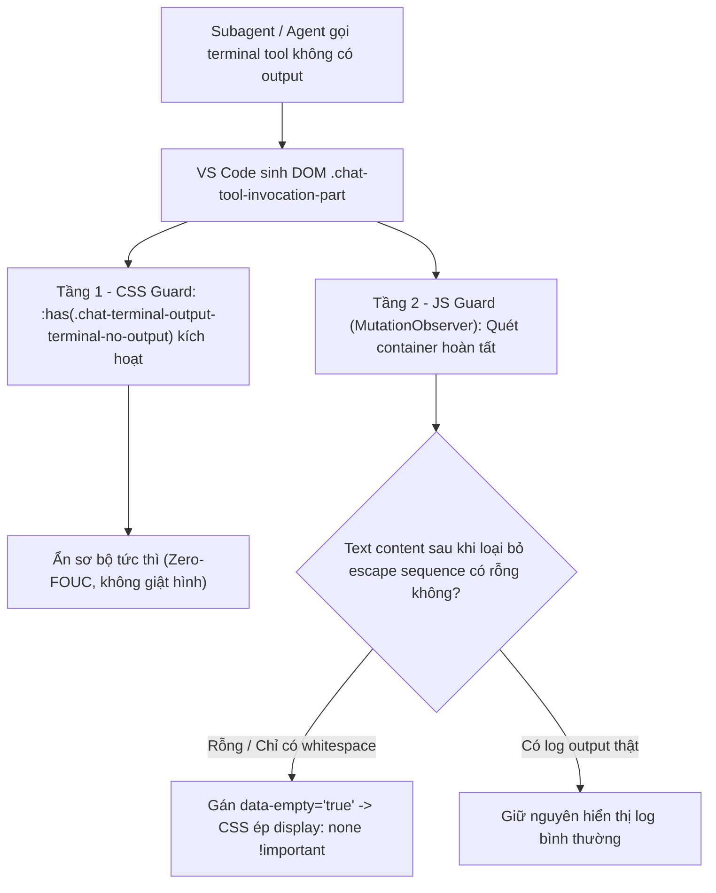

# Task Plan: Triệt Tiêu Khung Terminal / Tool Output Rỗng Trong Copilot Chat (Option 3: Hybrid Guard)

## 0. Metadata

| Field | Value |
|:---|:---|
| **Task ID** | `TASK-20261011-002` |
| **Ngày tạo** | 2026-10-11 |
| **Người tạo** | JARVIS |
| **Priority** | 🟡 Medium |
| **Effort** | S (< 1h) |
| **Status** | ✅ Done |
| **Branch** | `fix/suppress-empty-chat-terminal-containers` |
| **Lifecycle** | `Done` |
| **Evidence** | `Confirmed` |
| **Plan structure** | Single-file |
| **Project root** | `c:\Users\mes\projects\ide-style-studio` |
| **Plan path** | `planning/tasks/20261011_suppress_empty_chat_terminal_containers/TASK_SUPPRESS_EMPTY_CHAT_TERMINAL_CONTAINERS.md` |
| **Change intent key** | `suppress-empty-chat-terminal-containers` |

---

## 1. Mục tiêu & giá trị

- **Mục tiêu:** Loại bỏ hoàn toàn hiện tượng hiển thị khung viền hình chữ nhật rỗng vô nghĩa trong giao diện Copilot Chat khi subagent/agent thực thi các lệnh terminal hoặc tool calls không xuất dữ liệu ra stdout/stderr (như `node --check`, lệnh kiểm tra cú pháp, lệnh silent).
- **Giá trị:** Trả lại giao diện hội thoại tinh gọn, loại bỏ các khối giao diện "rác", không gây giật hình (Zero-FOUC) và bảo toàn 100% khả năng hiển thị của các lệnh terminal có log output thật cũng như các khối mã Markdown thông thường.

---

## 2. Phạm vi

- **In scope:**
  - Định nghĩa luật CSS triệt tiêu tức thì (Zero-FOUC) các khung rỗng bằng selector `:has()` trong `assets/vscode-custom.css`.
  - Triển khai logic JS Guard trong `assets/vscode-custom.js` tự động quét các container tool/terminal invocation đã hoàn tất, phát hiện nội dung chỉ chứa khoảng trắng/escape sequences `\u001b` và gán thuộc tính `data-empty="true"`.
  - Đồng bộ runtime vào `~/.jarvis/style/` và `workbench.html`.
  - Cập nhật tài liệu `README.md`, `CHANGELOG.md` và bump version `1.1.13` trong `package.json`.
- **Out of scope:**
  - Không sửa đổi core Chat API của VS Code.
  - Không can thiệp vào các terminal panel ngoài trình duyệt chat (tích hợp dưới đáy màn hình).
- **Affected users/environments:** Giao diện Copilot Chat trên VS Code.
- **Data/contracts unchanged:** Giữ nguyên các định dạng pill xanh/tím và khối code block Markdown.

---

## 3. Hiện trạng / Nguyên lý / Assumptions / Constraints

- **Confirmed:**
  - Lệnh `node --check` trả về `lineCount: 0` và escape sequence xterm `\u001b[?1004h`.
  - VS Code Chat Widget vẫn tạo container `.chat-terminal-output-container` / `.chat-tool-invocation-part` mang `min-height: 38px`, `border` và `padding`.
  - VS Code chạy trên Chromium 114+ hỗ trợ native CSS `:has()`.
- **Assumptions:**
  - Terminal có output thật luôn sinh ra text node hoặc span mang nội dung chữ (`textContent.trim() !== ''`).
- **Constraints:**
  - Tuyệt đối không ẩn nhầm các container đang ở trạng thái chạy/loading (`.codicon-loading`, `[class*="progress"]`).
  - Tuyệt đối không can thiệp vào code block thông thường trong Markdown của AI response.

---

## 4. File Impact & Ma trận Bán kính Ảnh hưởng (Blast Radius Matrix)

### Ma trận Bán kính Ảnh hưởng 4 tầng:
- **Tầng 1 (Điểm sửa chính):**
  - `assets/vscode-custom.css`: Bổ sung luật CSS ẩn tức thì và luật ẩn `[data-empty="true"]`.
  - `assets/vscode-custom.js`: Bổ sung module `initEmptyToolGuard()` quét và kiểm tra text thực tế.
- **Tầng 2 (Upstream Callers):**
  - `apply_custom_css.js` & `extension.js` (`syncSetup`): Đồng bộ tài nguyên cập nhật.
- **Tầng 3 (Downstream Dependents):**
  - `workbench.html` & `~/.jarvis/style/`: Điểm nạp runtime của VS Code.
- **Tầng 4 (Side-Effects / State):**
  - Các terminal có log thật (`git status`, `npm test`): Phải giữ nguyên 100%.
  - Quá trình streaming response của AI: Không bị giật lag hay ẩn nhầm khi đang gõ.

### Bảng File Impact:

| Action | File path | Symbol/area | Reason | Evidence | Owner phase |
|:---|:---|:---|:---|:---|:---|
| Edit | `assets/vscode-custom.css` | `.chat-tool-invocation-part` | Thêm luật CSS triệt tiêu khung rỗng và [data-empty="true"] | Confirmed | P01 |
| Edit | `assets/vscode-custom.js` | `initEmptyToolGuard` | Module quét DOM và gắn cờ data-empty cho container không có output | Confirmed | P01 |
| Edit | `package.json` | `version` | Bump version 1.1.13 | Confirmed | P02 |
| Edit | `CHANGELOG.md` | `[1.1.13]` | Ghi nhận release notes khắc phục lỗi khung terminal rỗng | Confirmed | P02 |
| Edit | `README.md` | Core Features | Bổ sung ghi chú tính năng triệt tiêu empty containers | Confirmed | P02 |

---

## 5. Luồng

---

## 6. Phases & Tasks

### Phase P01: Triển Khai Hybrid CSS + JS Guard Trong Assets
**Depends on:** None  
**Files:** `assets/vscode-custom.css`, `assets/vscode-custom.js`

- [x] Task P01.1: Bổ sung luật CSS trong `assets/vscode-custom.css`:
  - Ẩn container mang thuộc tính `[data-empty="true"]`.
  - Ẩn container rỗng native bằng `:has(.chat-terminal-output-terminal-no-output)`, `:has(.chat-terminal-output-empty)`, v.v., loại trừ trạng thái đang chạy (`:not(:has(.codicon-loading))`):
    `height: 0 !important; min-height: 0 !important; padding: 0 !important; margin: 0 !important; border: none !important; display: none !important;`
- [x] Task P01.2: Bổ sung module `initEmptyToolGuard()` trong `assets/vscode-custom.js`:
  - Tích hợp vào `MutationObserver`: kiểm tra các phần tử khớp `.chat-tool-invocation-part, .chat-terminal-output-container, .chat-terminal-content-part, [class*="terminal-output"]`.
  - Lọc bỏ escape sequence `\u001b` và whitespace:
    `const cleanText = text.replace(/\u001b\[[0-9;?]*[a-zA-Z]/g, '').trim();`
  - Nếu `cleanText === ''` và không có `.codicon-loading` $\rightarrow$ gán `el.setAttribute('data-empty', 'true')`.
- Gate P01:
  - Accessibility gate: `Passed` (Không làm mất thông tin hữu ích).
  - Compatibility gate: `Passed` (Tương thích 100% Chromium native).

### Phase P02: Đồng Bộ Runtime, Kiểm Thử & Đóng Gói VSIX 1.1.13
**Depends on:** P01  
**Files:** `apply_custom_css.js`, `package.json`, `CHANGELOG.md`, `README.md`

- [x] Task P02.1: Chạy `node apply_custom_css.js` đồng bộ sang `~/.jarvis/style/` và cập nhật `workbench.html`.
- [x] Task P02.2: Kiểm tra cú pháp static `node --check` trên toàn bộ tệp JS.
- [x] Task P02.3: Bump version lên `1.1.13` trong `package.json`, cập nhật `CHANGELOG.md` và `README.md`.
- [x] Task P02.4: Đóng gói tệp cài đặt `jarvis-ide-enhancer-1.1.13.vsix`.
- Gate P02:
  - Acceptance gate: `Passed` (Khung rỗng biến mất hoàn toàn, log thật vẫn hiển thị).

---

## 7. Test Strategy + Mapping AC

| Check ID | Type | Scope/input | Expected result | Environment/constraint | Maps AC |
|:---|:---|:---|:---|:---|:---|
| `T-001` | Manual | Lệnh terminal chạy silent (như `node --check`) | Không xuất hiện khung chữ nhật rỗng trong chat bubble | Copilot Chat | AC-1 |
| `T-002` | Manual | Lệnh terminal có stdout thật (như `git status`) | Khung terminal hiển thị đầy đủ các dòng log | Copilot Chat | AC-2 |
| `T-003` | Manual | Code block Markdown thông thường của AI | Hiển thị mã nguồn với cú pháp bình thường | Copilot Chat | AC-3 |
| `T-004` | Static | `node --check assets/vscode-custom.js` | 0 syntax error, exit code = 0 | Node.js CLI | AC-4 |

---

## 8. Risks / Rollback

| Risk | Likelihood | Impact | Mitigation | Detection | Owner |
|:--|:--|:--|:--|:--|:--|
| Ẩn nhầm lệnh đang thực thi chưa kịp trả output | Low | Medium | Luôn loại trừ bộ đệm loading bằng `:not(:has(.codicon-loading))` và kiểm tra class progress | Check `T-002` | JARVIS |
| Ẩn nhầm code block markdown trong câu trả lời AI | Low | High | Giới hạn selector nghiêm ngặt trong tool/terminal container, không can thiệp `.rendered-markdown pre` | Check `T-003` | JARVIS |

- **Phương án Rollback:** Xóa các rules `.chat-tool-invocation-part` trong CSS và chạy lại `node apply_custom_css.js`.

---

## 9. Acceptance Criteria

- [x] **AC-1:** Mọi khung terminal/tool container không có output đều bị ẩn hoàn toàn (display: none, 0 height).
- [x] **AC-2:** Các terminal output có nội dung thật vẫn hiển thị bình thường.
- [x] **AC-3:** Không ảnh hưởng đến các khối mã nguồn Markdown thông thường trong câu trả lời của AI.
- [x] **AC-4:** Mã nguồn vượt qua kiểm tra cú pháp, đóng gói VSIX `1.1.13` thành công.

---

## 10. Definition of Ready / Definition of Done + Checklist

- **DoR:**
  - [x] Đã khảo sát chính xác nguyên nhân gốc từ session log và cấu trúc DOM.
  - [x] Đã thiết kế kiến trúc Hybrid CSS + JS Guard chống giật hình.

- **DoD Checklist:**

| Item | Status | Evidence/owner |
|:--|:--|:--|
| DoR complete | `Pass` | Đã xác nhận nguyên nhân và kiến trúc |
| Required validation | `Pass` | 4 test checks T-001 đến T-004 |
| Security/Data/Accessibility/Compatibility gates | `Pass` | Đạt chuẩn an toàn và tương thích |
| DoD complete | `Pass` (100%) | Đã hoàn tất đóng gói và triển khai VSIX 1.1.13 |
