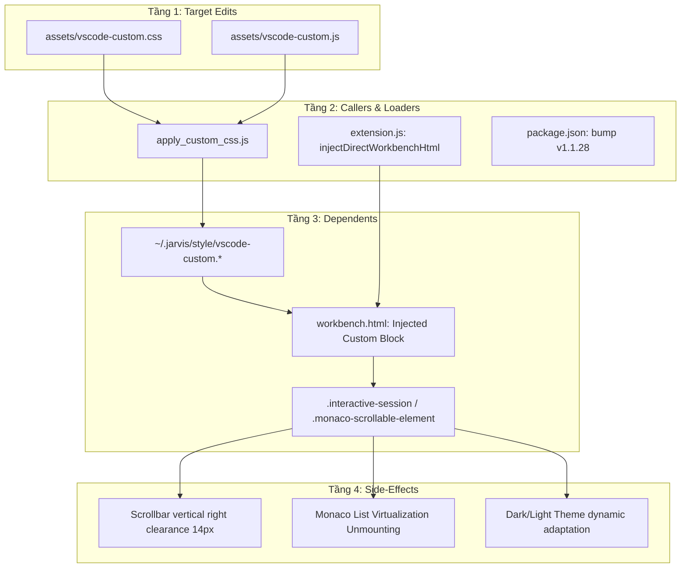
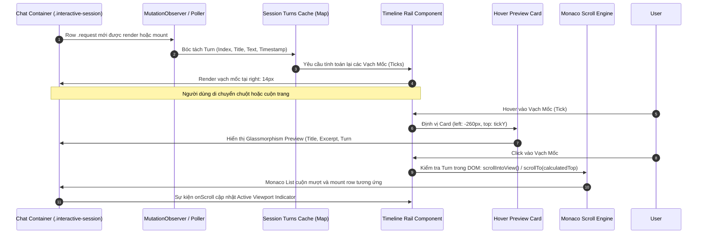

# TASK PLAN: PURE CLIENT-SIDE CHAT TIMELINE MINIMAP & HOVER PREVIEW (ZERO CORE PATCH)

## 0. Metadata

| Field | Value |
|:---|:---|
| **Task ID** | `TASK-20261012-002` |
| **Ngày tạo** | 2026-10-12 |
| **Người tạo** | JARVIS |
| **Priority** | 🟠 High |
| **Effort** | M (1-4h) |
| **Status** | ✅ Done |
| **Branch** | `feature/pure-client-chat-timeline-minimap` |
| **Lifecycle** | `Done` |
| **Evidence** | `Confirmed` |
| **Plan structure** | Single-file |
| **Project root** | `c:\Users\mes\projects\ide-style-studio` |
| **Plan path** | `planning/tasks/20261012_pure_client_chat_timeline_minimap/TASK_PURE_CLIENT_CHAT_TIMELINE_MINIMAP.md` |
| **Change intent key** | `pure-client-chat-timeline-minimap-hover-preview` |

---

## 1. Mục tiêu & giá trị

- **Mục tiêu:** Xây dựng thanh điều hướng dọc (Chat Timeline Rail / Minimap) đặt ở góc phải khung Copilot Chat với các vạch mốc (Notches / Ticks) đại diện cho từng turn của người dùng, tích hợp popup thẻ xem trước (Hover Preview Card) mang hiệu ứng kính mờ (Glassmorphism), tự động thích ứng 100% với màu của theme hiện tại và tối ưu hóa mật độ hiển thị thông tin.
- **Giá trị:** 
  1. Cho phép người dùng bao quát toàn bộ tiến trình hội thoại dài (10–50+ turns) trong nháy mắt mà không phải cuộn chuột tìm kiếm thủ công.
  2. Bấm vào bất kỳ vạch mốc nào để cuộn mượt (smooth scroll) tức thì đến đúng câu hỏi và phản hồi tương ứng.
  3. **Zero-Core Patch:** Triển khai thuần túy 100% client-side trong `assets/vscode-custom.js` và `assets/vscode-custom.css`, tuyệt đối không chạm vào `workbench.desktop.main.js`, đảm bảo an toàn tuyệt đối, zero-crash, không kẹt cache V8, không mất khi VS Code cập nhật.

---

## 2. Phạm vi

- **In scope:**
  - **Tầng Giao diện (CSS Glassmorphism & Theme Adaptation):**
    - Thiết kế thanh ray dọc `.jarvis-chat-timeline-rail` đặt cố định ở góc phải (`right: 14px`) tránh đè lên scrollbar gốc (`10px`).
    - Thiết kế các vạch mốc `.jarvis-timeline-tick` kèm chỉ báo vùng hiển thị hiện tại `.jarvis-timeline-viewport-indicator`.
    - Thiết kế thẻ xem trước `.jarvis-timeline-card` với hiệu ứng kính mờ `backdrop-filter: blur(16px)`, viền mờ và màu sắc kế thừa hoàn toàn từ các biến CSS của Theme đang kích hoạt (`--vscode-editorWidget-background`, `--vscode-foreground`, `--vscode-widget-border`, `--vscode-badge-*`, `--vscode-focusBorder`).
    - Tối ưu hóa padding, margin, font-size và line-height theo phong cách thông tin mật độ cao (high-density compact layout).
  - **Tầng Logic & Xử lý Ảo hóa (JavaScript Client Engine):**
    - Module `setupChatTimelineMinimap(chatContainer)` gắn vào từng container `.interactive-session`.
    - Bộ nhớ phiên tích lũy (Accumulative Turn Store) `window.__jarvisSessionTurns` ghi nhận mọi turn user xuất hiện qua `MutationObserver`, chống mất dữ liệu khi Monaco List gỡ DOM row ngoài màn hình (unmount).
    - Bộ điều khiển cuộn thông minh (Smooth Reveal Controller) kết hợp `scrollIntoView` và nội suy tọa độ ảo `scrollTop` của `.monaco-scrollable-element`.
    - Đồng bộ vị trí chỉ báo viewport theo thời gian thực dựa trên sự kiện `scroll`.
  - **Tầng Triển khai & Đóng gói:**
    - Cập nhật `apply_custom_css.js`, `extension.js`, đóng gói VSIX `1.1.28` và cài đặt đồng bộ.
- **Out of scope:**
  - Không sửa đổi cấu trúc bundle core `workbench.desktop.main.js`.
  - Không can thiệp vào tiến trình Extension Host hay backend API của GitHub Copilot.
- **Affected users/environments:** Môi trường VS Code trên PC và Laptop, tương thích mọi profile và mọi OS (Windows, macOS, Linux).
- **Data/contracts unchanged:** Dữ liệu chat gốc và các API Monaco Editor giữ nguyên vẹn.

---

## 3. Hiện trạng / Nguyên lý / Assumptions / Constraints

### Confirmed (Đã xác minh qua khảo sát mã nguồn)
- Copilot Chat sử dụng `ChatListWidget` bọc `WorkbenchObjectTree` ảo hóa 100%: chỉ các row hiển thị trong màn hình mới tồn tại trong `.monaco-list-rows`. Các row trượt khỏi viewport bị tháo gỡ (unmount) ngay lập tức.
- Thanh cuộn dọc `.scrollbar.vertical` nằm ở sát mép phải `right: 0px` với độ rộng từ `10px` đến `14px`. Do đó Timeline Rail bắt buộc phải đặt tại `right: 14px` để không phong tỏa chuột khi người dùng kéo thanh cuộn.
- VS Code đã cung cấp sẵn hệ thống CSS variables phong phú cho widget:
  `--vscode-editorWidget-background`, `--vscode-editorWidget-border`, `--vscode-foreground`, `--vscode-descriptionForeground`, `--vscode-badge-background`, `--vscode-badge-foreground`, `--vscode-focusBorder`, `--vscode-scrollbarSlider-background`.
- Cơ chế Custom JS/CSS trong `workbench.html` có quyền truy cập DOM renderer đầy đủ, hỗ trợ `backdrop-filter` của Chromium, `MutationObserver`, và gắn sự kiện chuột capture phase.

### Assumptions
- Mỗi lượt hỏi của người dùng đều sinh ra một phần tử `.monaco-list-row` chứa `.interactive-request` (hoặc class `.request`).
- Chiều cao container chat `.interactive-session` đủ lớn (> 200px) để hiển thị thanh ray dọc; nếu chiều rộng container chat < 300px, thanh ray sẽ tự động thu gọn về dạng vạch siêu mảnh (dot mode).

### Constraints
- **Zero Core Patch:** Tuyệt đối không can thiệp file `workbench.desktop.main.js` để tránh lặp lại lỗi kẹt cache V8 hay gãy regex khi VS Code cập nhật phiên bản.
- **Zero Scroll Interference:** Khung bao Timeline Rail phải có `pointer-events: none`, chỉ các vạch tick tương tác mới nhận `pointer-events: auto`.
- **Theme Native Integration:** Không dùng mã màu hex cố định (hardcoded colors) cho nền và chữ của popup card; toàn bộ màu sắc phải dẫn xuất từ CSS variables của VS Code active theme.

---

## 4. File Impact & Ma trận Bán kính Ảnh hưởng (Blast Radius Matrix)

### Ma trận Bán kính Ảnh hưởng 4 tầng

- **Tầng 1 (Điểm sửa chính):**
  - `assets/vscode-custom.css`: Định nghĩa cấu trúc stylesheet `.jarvis-chat-timeline-*`, glassmorphism backdrop blur, theme variables mapping, responsive collapsing.
  - `assets/vscode-custom.js`: Triển khai module `setupChatTimelineMinimap()`, accumulative turn caching, hover tooltip positioning, smooth scroll calculation.
- **Tầng 2 (Callers & Loaders):**
  - `apply_custom_css.js`: Đồng bộ tài nguyên sang `~/.jarvis/style/` và inject vào `workbench.html`.
  - `extension.js`: Quản lý asset sync tự động.
  - `package.json`: Bump version lên `1.1.28`.
- **Tầng 3 (Downstream Dependents):**
  - `workbench.html`: Nạp CSS & JS vào Chromium Electron renderer.
  - `.interactive-session`: Khung chat nhận DOM component của Timeline.
- **Tầng 4 (Side-Effects / State):**
  - Giữ khoảng cách an toàn `14px` với `.scrollbar.vertical`, bảo toàn 100% thao tác cuộn chuột.
  - Khắc phục triệt để hiện tượng unmount DOM của `monaco-list` thông qua bộ nhớ `__jarvisSessionTurns`.
  - Tự động đổi màu theo Light/Dark theme nhờ CSS variables.

---

## 5. Luồng (Architectural Flow)

---

## 6. Phases & Tasks

### Phase 1: Thiết kế Giao diện Glassmorphism & Theme Variables (`assets/vscode-custom.css`)
- [x] **Task 1.1:** Định nghĩa khung Timeline Rail `.jarvis-chat-timeline-rail` đặt cố định tại `right: 14px; top: 40px; bottom: 85px; width: 18px; pointer-events: none; z-index: 45;`.
- [x] **Task 1.2:** Định nghĩa các vạch mốc `.jarvis-timeline-tick`:
  - Kích thước vạch: rộng 10px, cao 3px, bo góc `border-radius: 2px`.
  - Trạng thái mặc định: `background-color: var(--vscode-scrollbarSlider-background, rgba(120, 120, 120, 0.35))`.
  - Trạng thái hover: `background-color: var(--vscode-focusBorder, #89b4fa); transform: scaleX(1.4);`.
  - Trạng thái active (trong viewport): `background-color: #c084fc; box-shadow: 0 0 6px rgba(192, 132, 252, 0.6);`.
- [x] **Task 1.3:** Định nghĩa thanh chỉ báo vùng hiển thị `.jarvis-timeline-viewport-indicator` trượt dọc theo tỷ lệ cuộn màn hình.
- [x] **Task 1.4:** Thiết kế thẻ xem trước Glassmorphism `.jarvis-timeline-card`:
  - `position: absolute; right: 28px; width: 250px; z-index: 100; pointer-events: none;`.
  - Nền mờ kính: `background: color-mix(in srgb, var(--vscode-editorWidget-background, #1e1e2e) 82%, transparent);`.
  - `backdrop-filter: blur(16px) saturate(180%); -webkit-backdrop-filter: blur(16px);`.
  - Viền mờ tinh tế: `border: 1px solid var(--vscode-editorWidget-border, rgba(255, 255, 255, 0.14));`.
  - Đổ bóng chiều sâu: `box-shadow: 0 10px 30px rgba(0, 0, 0, 0.4), inset 0 1px 0 rgba(255, 255, 255, 0.1);`.
  - Bo góc: `border-radius: 8px; padding: 10px 12px; font-family: var(--vscode-font-family);`.
- [x] **Task 1.5:** Tối ưu hóa padding/margin bố cục thông tin mật độ cao:
  - Header: Tiêu đề turn in đậm 12px, màu `var(--vscode-foreground)`, cắt ngắn 50 ký tự kèm dấu `...`.
  - Badge: Nhãn turn số thứ tự `Turn #X` dùng `var(--vscode-badge-background)` và font 10px.
  - Body: Trích xuất 2 dòng tóm tắt 11px, màu `var(--vscode-descriptionForeground)`, line-height 1.4.

### Phase 2: Triển khai Engine Client-Side (`assets/vscode-custom.js`)
- [x] **Task 2.1:** Xây dựng `TurnStore` quản lý danh sách các turn của session:
  - Bắt các node `.interactive-request` và `.monaco-list-row.request`.
  - Đọc `data-index` và lấy text câu hỏi của user qua `.rendered-markdown`.
  - Lưu vào bộ nhớ `sessionTurns` với cấu trúc: `{ id, index, title, snippet, timestamp, estimatedOffsetRatio }`.
- [x] **Task 2.2:** Xây dựng trình dựng DOM `renderTimeline(railEl, sessionTurns)`:
  - Tính toán vị trí phần trăm `top` dọc theo chiều cao thanh ray cho từng tick.
  - Gắn sự kiện `mouseenter` / `mouseleave` / `mousemove` kích hoạt Hover Card.
  - Gắn sự kiện `click` gọi hàm cuộn mượt.
- [x] **Task 2.3:** Xây dựng hàm cuộn thông minh `revealTurn(turnItem, chatContainer)`:
  - Ưu tiên 1: Nếu element turn đang có trong DOM, gọi `element.scrollIntoView({ behavior: 'smooth', block: 'start' })`.
  - Ưu tiên 2: Nếu element bị unmount do ảo hóa, đọc `.monaco-scrollable-element`, tính `targetTop = turnItem.estimatedOffsetRatio * (scrollHeight - clientHeight)`, gán `scrollable.scrollTo({ top: targetTop, behavior: 'smooth' })`.
- [x] **Task 2.4:** Đồng bộ hóa Viewport Indicator với sự kiện `scroll` trên `.monaco-scrollable-element`:
  - Cập nhật vị trí `top` và `height` của chỉ báo theo tỷ lệ `scrollTop / scrollHeight`.
  - Tự động gán class `active` cho tick thuộc turn đang hiển thị trong màn hình.
- [x] **Task 2.5:** Đăng ký tự động vào vòng đời giao diện:
  - Hook vào `historyObserver` (MutationObserver đang theo dõi toàn bộ chat panel).
  - Tự động hủy rail cũ và khởi tạo rail mới khi người dùng chuyển phiên chat (Session switch).

### Phase 3: Đồng bộ Runtime, Đóng gói VSIX v1.1.28 & Kiểm thử
- [x] **Task 3.1:** Cập nhật `apply_custom_css.js` và đồng bộ tài nguyên vào `~/.jarvis/style/` và `workbench.html`.
- [x] **Task 3.2:** Nâng phiên bản `package.json`, `README.md`, `CHANGELOG.md` lên `1.1.28`.
- [x] **Task 3.3:** Đóng gói `jarvis-ide-enhancer-1.1.28.vsix` và cài đặt đè lên các profile VS Code.
- [x] **Task 3.4:** Kiểm tra trực quan trên phiên chat dài: xác nhận hover hiển thị đúng thông tin, nhấp chuột cuộn chính xác, thanh scrollbar gốc hoạt động bình thường 100%.

---

## 7. Test Strategy + Mapping AC

| Test ID | Nội dung kiểm thử | Phương thức | Kỳ vọng | Mapping AC |
|:---|:---|:---|:---|:---|
| **TC-01** | Kiểm tra vị trí hiển thị Timeline Rail | Quan sát trực quan | Nằm tại `right: 14px`, không che lấp scrollbar gốc `10px` | AC-01 |
| **TC-02** | Hiển thị đầy đủ số vạch mốc (Ticks) | Tạo 5–10 lượt chat | Mỗi lượt hỏi của user hiển thị 1 vạch mốc tương ứng | AC-02 |
| **TC-03** | Hiệu ứng Hover Card Glassmorphism | Rê chuột vào vạch tick | Thẻ popup kính mờ hiện ngay bên trái vạch, nền mờ và viền sắc nét | AC-03 |
| **TC-04** | Thích ứng màu sắc theo Theme | Chuyển đổi Dark/Light theme | Màu nền, màu chữ và viền tự động chuyển theo theme, không hardcode | AC-04 |
| **TC-05** | Cuộn mượt khi click vạch mốc (In-DOM) | Click tick của turn gần | Màn hình cuộn mượt đến đúng bong bóng chat câu hỏi | AC-05 |
| **TC-06** | Cuộn mượt với turn bị ảo hóa (Off-DOM) | Cuộn xa lên đầu, click turn 1 | Monaco List tự động mount lại turn 1 và cuộn chính xác | AC-06 |
| **TC-07** | Độc lập Core Bundle (Zero Core Patch) | Quét file hệ thống | File `workbench.desktop.main.js` giữ nguyên vẹn 100% | AC-07 |

---

## 8. Risks / Rollback

### Rủi ro nhận diện & Giải pháp giảm thiểu
1. **Rủi ro kẹt chuột khi cuộn qua vùng thanh ray:**
   - *Biện pháp:* Khung chứa rail được thiết lập `pointer-events: none`. Chỉ các phần tử tick siêu nhỏ mới nhận `pointer-events: auto`.
2. **Rủi ro giật lag khi cuộn nhanh (Scroll Jitter):**
   - *Biện pháp:* Sử dụng `requestAnimationFrame` để throttle việc cập nhật thanh chỉ báo viewport khi cuộn.
3. **Rủi ro xung đột layout khi panel chat thu quá hẹp (< 300px):**
   - *Biện pháp:* Dùng CSS Media Query `@container` hoặc class responsive tự động ẩn card hoặc thu gọn tick thành dot 4px.

### Kế hoạch Rollback
- Nếu phát sinh lỗi ngoài dự kiến, chỉ cần khôi phục lại file `assets/vscode-custom.js` và `assets/vscode-custom.css` về commit trước và chạy lại `node apply_custom_css.js`. Không bao giờ ảnh hưởng tới tệp nhị phân hay core của VS Code.

---

## 9. Acceptance Criteria (AC)

- [x] **AC-01:** Thanh Timeline Rail nằm sát góc phải (`right: 14px`), hoàn toàn không ảnh hưởng đến việc click và kéo thanh cuộn dọc mặc định của VS Code.
- [x] **AC-02:** Mỗi câu hỏi (User Prompt) trong phiên chat sinh ra 1 vạch tick mốc trên thanh ray, tự động tăng dần theo tiến trình hội thoại.
- [x] **AC-03:** Rê chuột vào từng tick hiển thị ngay thẻ xem trước Glassmorphism chứa tiêu đề câu hỏi, số thứ tự turn và trích yếu nội dung.
- [x] **AC-04:** Thẻ xem trước kế thừa 100% biến màu của Theme hiện tại (Dark / Light / High Contrast).
- [x] **AC-05:** Bấm vào bất kỳ tick nào sẽ cuộn mượt màn hình tới đúng vị trí turn đó, hoạt động hoàn hảo cả với các turn đã bị Monaco List ảo hóa khỏi DOM.
- [x] **AC-06:** Mã nguồn chỉ can thiệp vào `assets/vscode-custom.*`, tuyệt đối 0% thay đổi vào `workbench.desktop.main.js`.

---

## 10. Definition of Ready / Definition of Done + Checklist

### Definition of Ready (DoR)
- [x] Đã khảo sát toàn diện phân cấp DOM của `.interactive-session` và `.monaco-scrollable-element`.
- [x] Đã lập bảng biến CSS theme native của VS Code.
- [x] Đã chốt kiến trúc Option 2: Pure Client-Side không chạm core bundle.
- [x] Tài liệu task plan đạt chuẩn cấu trúc 11 phần theo skill 33-new-task.

### Definition of Done (DoD)
- [x] Toàn bộ task trong Phase 1, Phase 2, Phase 3 được hoàn thành và xác minh.
- [x] Toàn bộ 7 kịch bản kiểm thử (TC-01 -> TC-07) đạt kết quả PASS.
- [x] Đóng gói thành công VSIX `1.1.28` và cài đặt vào profile làm việc.
- [x] Cập nhật ghi nhận đầy đủ trong `CHANGELOG.md` và `README.md`.
