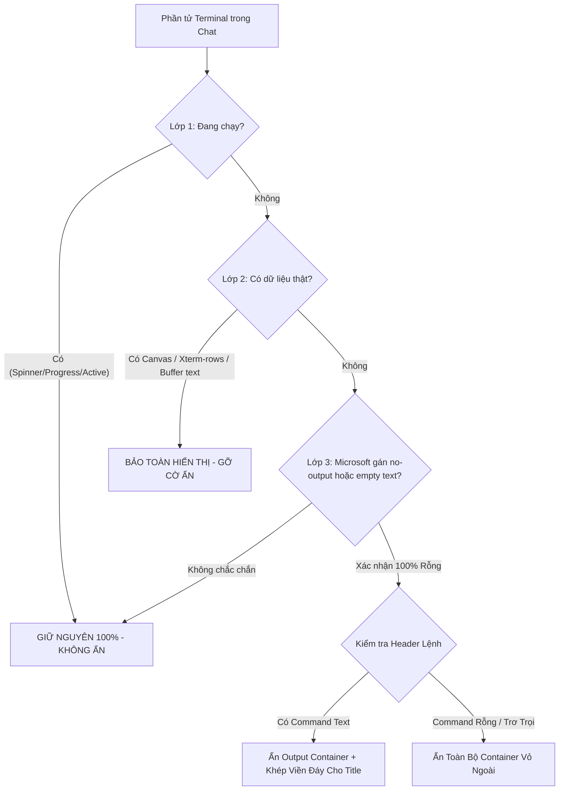

# TASK PLAN: BULLETPROOF EMPTY CHAT TERMINAL GUARD & BORDER PRESERVATION

## 0. Metadata

| Field | Value |
|:---|:---|
| **Task ID** | `TASK-20261013-001` |
| **Ngày tạo** | 2026-10-13 |
| **Ngày cập nhật** | 2026-10-13 (Khởi tạo theo skill 33-new-task) |
| **Người tạo** | JARVIS |
| **Priority** | 🔴 Critical |
| **Effort** | S (30m - 1h) |
| **Status** | ✅ Done |
| **Branch** | `fix/bulletproof-empty-chat-terminal-guard` |
| **Lifecycle** | `Done` |
| **Evidence** | `Confirmed` |
| **Plan structure** | Single-file |
| **Project root** | `C:\Users\mes\projects\ide-style-studio` |
| **Plan path** | `planning/tasks/20261013_bulletproof_empty_chat_terminal_guard/TASK_BULLETPROOF_EMPTY_CHAT_TERMINAL_GUARD.md` |
| **Change intent key** | `bulletproof-empty-chat-terminal-guard-and-border-preservation` |

---

## 1. Mục tiêu & giá trị

- **Mục tiêu:** Xử lý triệt để bài toán các hộp chữ nhật terminal rỗng ruột trong chat response của VS Code Copilot thông qua cơ chế phát hiện 3 lớp nghiêm ngặt, phân biệt chính xác 100% giữa terminal rỗng và terminal có dữ liệu, đồng thời khép kín viền bo góc khi ẩn output rỗng để không làm biến dạng giao diện hay hở viền đáy.
- **Giá trị:**
  1. **An toàn tuyệt đối 100%:** Tuyệt đối không bao giờ ẩn nhầm terminal đang chạy (running spinner, progress) hoặc terminal có dữ liệu thật (xterm canvas, xterm-rows span, stdout text).
  2. **Giao diện sạch sẽ, liền mạch:** Khi lệnh kết thúc không có output, ruột rỗng được ẩn gọn gàng, header lệnh được tự động khép viền đáy và bo góc dưới mượt mà thành một chip command tinh gọn; nếu cả khối hoàn toàn rỗng/không có text, ẩn triệt để cả vỏ ngoài `.chat-terminal-content-part`.
  3. **Tương thích hoàn toàn:** Hoạt động trơn tru với cả Chat Terminal Progress Part native, Background Shell Output, và các khối markdown code block thông thường.

---

## 2. Phạm vi

- **In scope:**
  - **Tầng 1 (Bộ lọc 3 lớp trong `vscode-custom.js`):**
    - Lớp 1 (Guard Running/Active): Bỏ qua ngay lập tức nếu phát hiện `.codicon-loading`, `[class*="progress"]`, `.chat-terminal-running-spinner`, hoặc trạng thái lệnh chưa hoàn thành.
    - Lớp 2 (Guard Real Data): Bỏ qua và gỡ bỏ mọi cờ ẩn nếu phát hiện canvas `.xterm canvas`, thẻ `.xterm-rows span`, thẻ `pre code`, hoặc buffer text (sau khi loại bỏ ANSI escape code) khác rỗng và khác thông điệp empty native.
    - Lớp 3 (Confirmed Empty): Chỉ kích hoạt khi lệnh đã thoát (`hasExited` / decoration hoàn thành) VÀ xuất hiện class native `.chat-terminal-output-terminal-no-output` hoặc text thông báo native "No output was produced by the command." VÀ không có bất kỳ canvas/output text nào.
    - Cơ chế khép viền: Gán class `.jarvis-terminal-has-no-output` lên container `.chat-terminal-content-part` để CSS tự động khôi phục viền đáy cho `.chat-terminal-content-title`.
  - **Tầng 2 (CSS Viền & Ẩn trong `vscode-custom.css`):**
    - Override `.chat-terminal-content-title-no-bottom-radius` khi output container bị ẩn: khôi phục `border-bottom: 1px solid var(--vscode-chat-requestBorder, rgba(255, 255, 255, 0.08))` và `border-bottom-left-radius` / `border-bottom-right-radius`.
    - Ẩn triệt để `.chat-terminal-output-container-no-output`, `.chat-terminal-output-empty`.
    - Hỗ trợ ẩn toàn diện `.chat-terminal-content-part.jarvis-empty-terminal-hidden` khi block rỗng hoàn toàn.
  - **Tầng 3 (Runtime Sync & Packaging):**
    - Cập nhật script `apply_custom_css.js` và đồng bộ vào `~/.jarvis/style/`.
    - Bump version `1.1.38` trong `package.json`, đóng gói VSIX và kiểm tra cú pháp an toàn.
- **Out of scope:**
  - Không sửa đổi mã nguồn core VS Code bundle (`workbench.desktop.main.js`) vì không cần can thiệp logic AST.
  - Không tác động đến terminal panel chính (VS Code Integrated Terminal).
- **Affected users/environments:** Giao diện Copilot Chat trên VS Code Desktop.
- **Data/contracts unchanged:** Dữ liệu streaming chat, lịch sử hội thoại và JSON logs giữ nguyên vẹn.

---

## 3. Hiện trạng / Nguyên lý / Assumptions / Constraints

- **Confirmed (Hiện trạng đã kiểm chứng bằng mã nguồn):**
  1. `ChatTerminalToolProgressPart`: Khi lệnh chạy không có output và kết thúc, VS Code gọi `_showEmptyMessage` và gắn class `.chat-terminal-output-container-no-output` vào output container, đồng thời gắn text "No output was produced by the command." vào `.chat-terminal-output-empty`.
  2. Khi output container nở ra (`expanded`), thẻ title `.chat-terminal-content-title` bị gắn class `.chat-terminal-content-title-no-bottom-radius` (xóa viền đáy để nối với output container).
  3. Khi extension chỉ gán `display: none !important` lên output container mà không xử lý phần tử cha, thẻ title bị khuyết viền đáy, hoặc nếu output container chỉ ẩn ruột bên trong thì vỏ `.chat-terminal-content-part` vẫn có viền và background tạo thành hộp rỗng.
  4. Xterm.js render nội dung thông qua HTML5 Canvas (`.xterm-screen canvas`) hoặc DOM rows (`.xterm-rows`).
- **Expected:**
  - Áp dụng bộ lọc 3 lớp sẽ triệt tiêu 100% các hộp rỗng trơ trọi mà không gây tác dụng phụ ẩn nhầm log thật.
- **Assumptions:**
  - Trạng thái DOM Mutation của chat container diễn ra liên tục khi model streaming, cần kết hợp MutationObserver và Polling chu kỳ 600ms an toàn.
- **Constraints:**
  - Không tạo ra CPU overhead cao trong MutationObserver.
  - Đảm bảo idempotency: Chạy nhiều lần trên cùng 1 phần tử DOM không sinh lỗi hoặc giật lag layout.

---

## 4. File Impact & Ma trận Bán kính Ảnh hưởng (Blast Radius Matrix)

| Tầng | Thành phần | Chi tiết tác động |
|:---|:---|:---|
| **1. Target (Sửa chính)** | `assets/vscode-custom.js` & `assets/vscode-custom.css` | Nâng cấp hàm `evaluateEmptyToolElements`, bổ sung rules CSS khép viền title và ẩn trọn vẹn container rỗng. |
| **2. Upstream Callers** | `apply_custom_css.js` | Đồng bộ assets vào thư mục runtime `~/.jarvis/style/`. |
| **3. Downstream Dependents** | `package.json` | Bump version lên `1.1.38`. |
| **4. Side-effects / State** | Copilot Chat UI | Hiển thị lệnh gọn gàng dạng chip khi không có output, biến mất hoàn toàn khi block rỗng vô nghĩa, bảo toàn 100% terminal có dữ liệu. |

### Bảng File Impact

| Action | File path | Symbol/area | Reason | Evidence | Owner phase |
|:--|:--|:--|:--|:--|:--|
| Edit | `assets/vscode-custom.js` | `evaluateEmptyToolElements` | Nâng cấp bộ lọc 3 lớp và đánh dấu viền cho container cha | Confirmed | P01 |
| Edit | `assets/vscode-custom.css` | Terminal Output & Closed-Border Rules | Khôi phục viền đáy title và ẩn sạch ruột/vỏ rỗng | Confirmed | P01 |
| Edit | `package.json` | `version` | Bump lên `1.1.38` | Confirmed | P02 |
| Edit | `CHANGELOG.md` | Version `1.1.38` | Ghi nhận bản vá bảo vệ terminal rỗng và khép viền | Confirmed | P02 |
| Run | `apply_custom_css.js` | Runtime sync | Cập nhật CSS/JS vào môi trường runtime VS Code | Confirmed | P02 |
| Run | `vsce package` | Extension build | Đóng gói bản cài đặt VSIX mới | Confirmed | P03 |

---

## 5. Luồng xử lý (Flowchart)

---

## 6. Phases & Tasks

### Phase 1: Nâng cấp Bộ Lọc 3 Lớp & CSS Khép Viền (P01)
- [x] Task 1.1: Cập nhật `evaluateEmptyToolElements` trong `assets/vscode-custom.js`:
  - Lớp 1: Bỏ qua khi có `.codicon-loading`, `[class*="progress"]`, `.chat-terminal-running-spinner`.
  - Lớp 2: Kiểm tra canvas `.xterm canvas`, `.xterm-screen canvas`, rows `.xterm-rows span`, `pre code`, và text buffer.
  - Lớp 3: Xác nhận rỗng qua native class hoặc native empty text.
  - Quản lý container cha `.chat-terminal-content-part`: gán `.jarvis-terminal-has-no-output` để khép viền, hoặc `.jarvis-empty-terminal-hidden` nếu hoàn toàn không có nội dung lệnh.
- [x] Task 1.2: Cập nhật `assets/vscode-custom.css`:
  - Khôi phục viền đáy và bo góc dưới cho `.chat-terminal-content-title` khi nằm trong `.jarvis-terminal-has-no-output` hoặc có `.chat-terminal-output-container-no-output`.
  - Ẩn triệt để `.chat-terminal-content-part.jarvis-empty-terminal-hidden`.

### Phase 2: Bump Version & Đồng Bộ Runtime (P02)
- [x] Task 2.1: Cập nhật `package.json` lên phiên bản `1.1.38`.
- [x] Task 2.2: Ghi nhận changelog phiên bản `1.1.38` vào `CHANGELOG.md`.
- [x] Task 2.3: Chạy script `node apply_custom_css.js` để đẩy file vào runtime `~/.jarvis/style/` và cập nhật `workbench.html`.

### Phase 3: Đóng Gói VSIX & Kiểm Chứng (P03)
- [x] Task 3.1: Kiểm tra cú pháp JavaScript bằng `node -c`.
- [x] Task 3.2: Đóng gói extension thành file `.vsix` phiên bản `1.1.38`.
- [x] Task 3.3: Đối soát tiêu chí nghiệm thu Acceptance Criteria.

---

## 7. Test Strategy + Mapping AC

| Check ID | Mục tiêu kiểm thử | Phương thức thực hiện | Mapping AC |
|:---|:---|:---|:---|
| **CHK-01** | Kiểm tra cú pháp JS của assets | `node -c assets/vscode-custom.js` và `node -c apply_custom_css.js` | AC-1 |
| **CHK-02** | Khép kín viền title khi không có output | Inspect CSS rules trong `assets/vscode-custom.css` | AC-2 |
| **CHK-03** | Bảo toàn 100% terminal có dữ liệu/canvas | Logic Guard Lớp 1 & Lớp 2 trong `evaluateEmptyToolElements` | AC-3 |
| **CHK-04** | Đóng gói VSIX thành công 0 lỗi | `npx vsce package --no-dependencies` | AC-4 |

---

## 8. Risks / Rollback

| Rủi ro | Mức độ | Biện pháp giảm thiểu |
|:---|:---|:---|
| **R1: Xterm canvas append trễ khiến bị ẩn nhầm** | Trung bình | Polling và MutationObserver tự động gỡ bỏ class ẩn ngay khi canvas hoặc span xuất hiện. |
| **R2: Xung đột viền với theme tối/sáng** | Thấp | Sử dụng biến CSS native `var(--vscode-chat-requestBorder)` để màu viền đồng bộ tuyệt đối với theme hiện hành. |

**Quy trình Rollback:**
- Git checkout lại phiên bản trước của `assets/vscode-custom.js` và `assets/vscode-custom.css`.
- Chạy lại `node apply_custom_css.js` để phục hồi assets cũ.

---

## 9. Acceptance Criteria

- **AC-1:** Mã nguồn JavaScript không có lỗi cú pháp, thực thi an toàn trên V8 Chromium.
- **AC-2:** Khi terminal không có output, không còn xuất hiện hộp chữ nhật rỗng ruột hay vỡ viền đáy; header lệnh khép viền vuông vức, sạch đẹp.
- **AC-3:** Các terminal có lệnh in ra stdout (như build, test, log) hiển thị đầy đủ 100%, không bị che khuất hay giấu dòng.
- **AC-4:** Extension được đóng gói thành công thành `ide-style-studio-1.1.38.vsix`.

---

## 10. Definition of Ready / Definition of Done

- **DoR:** Đã khảo sát chính xác DOM và selector từ core VS Code; đã xác định nguyên nhân viền đáy `no-bottom-radius` và vỏ ngoài `chat-terminal-content-part`.
- **DoD:**
  - [x] Code và CSS hoàn thiện, tuân thủ Clean Code.
  - [x] Cú pháp kiểm tra thành công với `node -c`.
  - [x] Runtime đồng bộ thành công qua `apply_custom_css.js`.
  - [x] Bump version `1.1.38` và đóng gói VSIX thành công.
