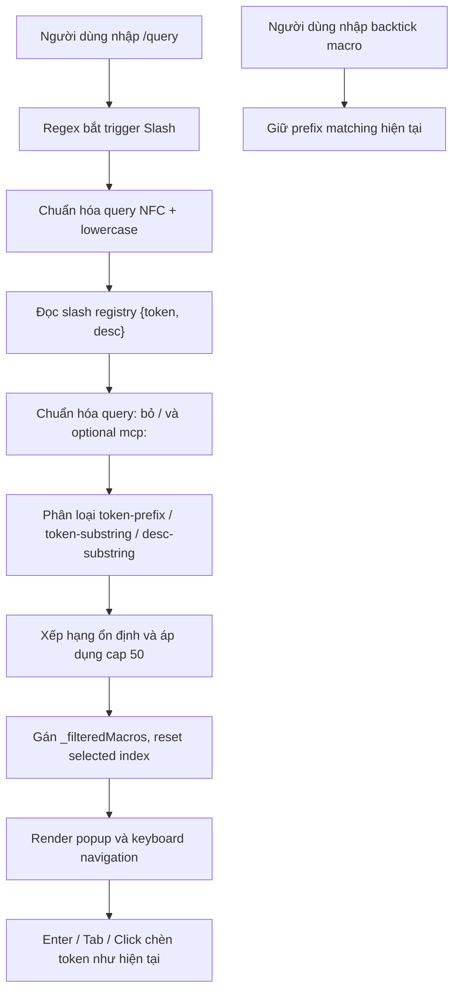

# Task Plan: Tìm kiếm rộng trong Slash Autocomplete

## 0. Metadata

| Field | Value |
|:---|:---|
| **Task ID** | `TASK-20261020-002` |
| **Ngày tạo** | 2026-10-20 |
| **Người tạo** | JARVIS |
| **Priority** | 🟡 Medium |
| **Effort** | M (1-4h) |
| **Status** | ⏳ P01 Implemented; UI/Release Pending |
| **Branch** | `feature/broad-autocomplete-search` |
| **Lifecycle** | `In Progress` |
| **Evidence** | `Confirmed` |
| **Plan structure** | Single-file |
| **Project root** | `c:\Users\mes\projects\ide-style-studio` |
| **Plan path** | `planning/tasks/20261020_broad_autocomplete_token_description_search/TASK_BROAD_AUTOCOMPLETE_TOKEN_DESCRIPTION_SEARCH.md` |
| **Change intent key** | `autocomplete_substring_token_description_ranking` |

---

## 1. Mục tiêu & giá trị

Cải thiện tìm kiếm trong popup autocomplete: với truy vấn slash như `/mes` hoặc `/mcp:mes`, tìm được `/mcp:oracle-mes-test` nhờ khớp chuỗi con trong token, đồng thời tìm theo description. Kết quả ưu tiên khớp tiền tố trước, sau đó khớp trong token, rồi description; giữ nguyên cách chọn và chèn token hiện có. Tìm kiếm backtick macro giữ nguyên prefix matching hiện tại.

---

## 2. Phạm vi

- **In scope:**
  - Mở rộng matching Slash trong `setupMacroAutocomplete()` để tìm substring không phân biệt hoa/thường trong token và description.
  - Xếp hạng rõ ràng: token bắt đầu bằng query → substring token → description; giữ thứ tự nguồn ổn định khi đồng hạng.
  - Giới hạn kết quả gợi ý tối đa 50 items; áp dụng cap sau xếp hạng và dùng cùng một mảng cho render/navigation/selection.
  - Chuẩn hóa chuỗi Unicode NFC trước khi so sánh, không tự ý bỏ dấu tiếng Việt.
  - Giữ nguyên trigger `/` và backtick, cách thay thế token, keyboard selection và giao diện pill.

- **Out of scope:**
  - Không mở popup chỉ với truy vấn trần `mes` (không có `/`/backtick).
  - Không tìm trong cấu hình MCP, command/args/env, nguồn internet hoặc secret.
  - Không thay đổi registry schema `{ token, desc }`, MCP discovery, CSS, cấu hình editor hay VS Code core.
  - Không thêm fuzzy distance/typo tolerance hoặc tìm kiếm nhiều từ trong nhiều trường; chỉ substring literal trong token/description.

- **Affected users/environments:** Người dùng JARVIS IDE Enhancer khi nhập lệnh trong Copilot Chat Monaco Editor.
- **Data/contracts unchanged:** Registry `{ token, desc }`, selection/caret/replace-range contract, trigger syntax, pill decoration và MCP secrets handling không đổi.

---

## 3. Hiện trạng / Nguyên lý / Assumptions / Constraints

### Confirmed
- `assets/vscode-custom.js` — `setupMacroAutocomplete()` nhận diện trigger bằng regex `/(?:^|[\s>:,;])([`/][\p{L}0-9_.:-]*)$/u`.
- Slash command và backtick macro hiện lọc riêng bằng `m.token.toLowerCase().startsWith(prefix)`; slash không tìm trong `desc`.
- `getActiveSlashCommands()` và `getActiveMacros()` cung cấp registry; slash objects có `{ token, desc }`.
- Mỗi lần lọc, `_filteredMacros` nhận toàn bộ danh sách, `_selectedMacroIndex` đặt về 0; popup, ArrowUp/Down, Enter/Tab và click dùng danh sách này.
- `renderMacroPopup()` render token và description; `applyMacroToEditor()` chèn `macro.token + ' '`.
- Không tìm thấy test suite riêng trong repository. `package.json` lint hiện kiểm tra `extension.js`, không bao gồm UI script.

### Expected
- Gõ `/mes` hoặc `/mcp:mes` hiển thị MCP `/mcp:oracle-mes-test`.
- Query khớp phần đầu token được xếp trên substring token; token substring được xếp trên description-only.
- Backtick macro giữ nguyên prefix matching, trừ khi FOUNDER xác nhận muốn áp dụng broad search cho cả macro.

### To verify
- Quyết định kết quả cap chính xác khi triển khai; baseline đề xuất 50.
- Đánh giá có cần tìm nhiều từ trong description hay không; bản đầu chỉ hỗ trợ substring liên tục.

### Assumptions / Constraints
- Query chỉ gồm token hiện tại kết thúc tại con trỏ; regex không hỗ trợ khoảng trắng nội bộ nên description search hiện có nghĩa query ngắn/liền mạch.
- Matching không phân biệt hoa/thường, Unicode NFC; không bỏ dấu để tránh các va chạm kết quả ngoài ý muốn.
- Không thêm dependency. Rủi ro thay đổi ở client-side script thấp; phải `node --check` script trước build.
- Query search key: loại bỏ dấu `/` mở đầu; nếu phần còn lại bắt đầu bằng `mcp:` thì loại bỏ prefix đó. So sánh literal substring trên token không gồm `/` mở đầu và trên description. Vì vậy `/mes` và `/mcp:mes` đều tìm được `/mcp:oracle-mes-test`.
- Query rỗng sau trigger (chỉ `/`) giữ hành vi mở danh sách slash, giới hạn 50 kết quả theo thứ tự registry; query không rỗng nhưng không match thì ẩn popup như logic hiện tại.
- Matching là literal substring, không fuzzy, không tìm nhiều từ; không bỏ dấu. `normalize('NFC').toLowerCase()` được dùng thống nhất.

---

## 4. File Impact & Ma trận Bán kính Ảnh hưởng

### Ma trận 4 tầng

1. **Target:** `assets/vscode-custom.js` — nhánh matching slash bên trong `setupMacroAutocomplete()`. Không cần thay accessor registry hoặc data producer.
2. **Upstream Callers:** `attachChatPillDecorations()` gọi `setupMacroAutocomplete()` khi editor được gắn; editor watcher gọi `checkAndTriggerAutocomplete()` khi nội dung/con trỏ thay đổi. Các dòng call sites không cần sửa.
3. **Downstream Dependents:** `getActiveSlashCommands()` trả `{token, desc}`; kết quả trở thành `_filteredMacros`, rồi `renderMacroPopup()`, keyboard selection và `applyMacroToEditor()` tiêu thụ danh sách. Giữ invariant: danh sách render = danh sách navigation = danh sách có thể được chọn.
4. **Side-effects / State:** Nhiều kết quả hơn có thể tăng DOM nodes; áp dụng cap sau ranking và trước render/navigation. Reset index về 0 sau mỗi query; tie-break ổn định theo thứ tự registry. Không thay luồng backtick; không truy cập filesystem/MCP runtime; không ảnh hưởng CSS/core.

### File Impact

| Action | File path | Symbol/area | Reason | Evidence | Owner phase |
|:---|:---|:---|:---|:---|:---|
| Edit | `assets/vscode-custom.js` | `setupMacroAutocomplete()` / `checkAndTriggerAutocomplete()` | Thêm normalize, phân loại match và xếp hạng slash results; giữ nguyên nhánh backtick | `Confirmed` | `P01` |
| Create | `test/autocomplete-search.test.js` | Built-in `node:test` / `node:assert` | Runnable checks cho canonicalization, matching, ranking, cap và Unicode | `Expected` | `P01` |
| Create | `planning/tasks/20261020_broad_autocomplete_token_description_search/TASK_BROAD_AUTOCOMPLETE_TOKEN_DESCRIPTION_SEARCH.md` | Task plan | Ghi đặc tả, gates và test mapping | `Confirmed` | Master |

---

## 5. Luồng

Sơ đồ chưa xác minh bằng renderer thực tế.

---

## 6. Phases & Tasks

### P01 — Matching, ranking và bảo toàn UI contract
**Depends on:** None  
**Files:** `assets/vscode-custom.js`, `test/autocomplete-search.test.js`, task plan  
**Entry gate:** Code hiện tại được kiểm tra; token/description fields là chuỗi theo registry contract.  
**Exit gate:** Slash query substring hoạt động, backtick prefix không đổi, danh sách render/navigation đồng nhất.

- [x] **Task P01.1 — Viết pure helper chuẩn hóa và xếp hạng slash matches**
  - File: `assets/vscode-custom.js`.
  - Tách logic nhỏ trong IIFE gần `setupMacroAutocomplete`; không thêm abstraction đa file.
  - Normalize `query`, `token`, `desc` bằng `String(value || '').normalize('NFC').toLowerCase()`.
  - Bỏ dấu `/` đầu query, rồi optional prefix `mcp:`; loại `/` đầu token trước khi so sánh.
  - Nhóm thứ tự: token body bắt đầu bằng query cao nhất; token body chứa query tiếp theo; description chứa query thấp nhất. Dùng original index làm tie-break ổn định, không mutate registry.
  - Với query rỗng từ trigger `/`, trả tối đa 50 slash items theo thứ tự registry; không để `includes('')` vô tình xếp tất cả thành nhóm description.
  - Bỏ record có token không phải string/non-empty để tránh runtime exceptions với custom registry lỗi định dạng.
  - Không đọc/render HTML từ desc; giữ `textContent` hiện tại.
  - Giữ helper thuần trong `assets/vscode-custom.js`; viết `test/autocomplete-search.test.js` bằng `node:test`/`node:assert` built-in. Test harness đọc helper source qua marker comment ổn định và chạy trong `node:vm`; không expose helper lên `window` và không thêm dependency.
- [x] **Task P01.2 — Gắn helper vào nhánh slash, giữ nguyên nhánh backtick**
  - File: `assets/vscode-custom.js`.
  - Slash: dùng helper tìm token/description, ranking, cap 50.
  - Backtick: giữ nguyên `startsWith(prefix)` và thứ tự dữ liệu hiện tại.
  - Không đổi `_currentReplaceRange`, `_filteredMacros`, `_selectedMacroIndex = 0`, popup placement hoặc `applyMacroToEditor()`.
- [x] **Task P01.3 — Tạo runnable unit checks và kiểm thử hồi quy autocomplete**
  - Files: `assets/vscode-custom.js`, `test/autocomplete-search.test.js`.
  - Positive: `/mes` và `/mcp:mes` → `/mcp:oracle-mes-test`; `/oracle` → cùng token; một từ có trong description → kết quả phù hợp.
  - Ranking: exact/prefix trước substring token, token trước description; hòa điểm giữ thứ tự registry.
  - Negative: query không khớp không hiện popup; `/` trả danh sách cap 50; sai kiểu dữ liệu bỏ qua an toàn.
  - Regression: lệnh slash prefix cũ vẫn hoạt động; backtick macro vẫn prefix-only; Enter/Tab/ArrowUp/ArrowDown/click chọn đúng item và chèn token nguyên vẹn.
  - Unicode: NFC và NFD tương đương sau normalization; không bỏ dấu.
  - Runnable command: `node --test test/autocomplete-search.test.js`.

**Security gate:** Không áp dụng (không đọc secret hay nguồn ngoài); vẫn giữ an toàn text rendering qua `textContent`.  
**Data gate:** Không áp dụng.  
**Accessibility gate:** Kiểm tra keyboard navigation khi cap; item được chọn luôn scroll vào vùng nhìn thấy.  
**Compatibility gate:** Không đổi schema, editor API, trigger regex, slash insertion contract hay backtick behavior.

---

## 7. Test Strategy + mapping AC

| Check ID | Type | Scope/input | Expected result | Environment/constraint | Maps AC |
|:---|:---|:---|:---|:---|:---|
| `T-001` | Unit | `/mes`, `/mcp:mes`, registry có `/mcp:oracle-mes-test` | Cả hai query trả token oracle MES | `node --test test/autocomplete-search.test.js` | `AC-1` |
| `T-002` | Unit | Kết quả prefix, substring token, description | Thứ tự prefix > token substring > description; tie giữ source order | `node --test test/autocomplete-search.test.js` | `AC-2` |
| `T-003` | Unit | Upper/lowercase, NFC/NFD | Case-insensitive; NFC/NFD normalize nhất quán, không bỏ dấu | `node --test test/autocomplete-search.test.js` | `AC-3` |
| `T-004` | Unit/Negative | Query `/`, không match, record sai kiểu, >50 results | Không crash; `/` cap 50 theo source; no match ẩn; cap đúng | `node --test test/autocomplete-search.test.js` | `AC-4` |
| `T-005` | Regression | Slash command + backtick macro | Slash cũ hoạt động; backtick vẫn prefix-only | `node --test test/autocomplete-search.test.js` + syntax check | `AC-5` |
| `T-006` | Manual/UI | ArrowUp/Down, Enter, Tab, click sau ranking/cap | Item hiển thị = item điều hướng/chọn; chèn đúng token | VS Code Copilot Chat | `AC-4`, `AC-5` |

AC-1..AC-5 phải map tới tối thiểu một test ở trên. Không khai báo pass cho UI manual khi chưa thao tác trên editor.

---

## 8. Risks / Rollback

| Risk | Likelihood | Impact | Mitigation | Detection | Owner |
|:---|:---:|:---:|:---|:---|:---|
| Description substring tạo kết quả nhiễu | Medium | Low | Ranking token match cao hơn description; cap 50; stable tie-break | T-002, T-006 | Worker |
| Cap làm người dùng không thấy kết quả cần tìm | Low | Medium | Xếp hạng trước khi cap; chọn 50 sau khi xác nhận danh sách thực tế; query cụ thể vẫn truy cập được | T-004 | Worker |
| Macro backtick thay đổi ngoài ý muốn | Low | Medium | Duy trì nhánh prefix cũ riêng biệt, test regression | T-005 | Worker |
| Unicode normalization gây không tương thích runtime | Low | Medium | Kiểm tra `.normalize('NFC')` trên runtime VS Code; fallback thuần JS nếu cần | T-003, `node --check` | Worker |
| Sai mapping selection sau sort/cap | Low | High | Một mảng kết quả duy nhất là nguồn cho render, keyboard, apply; test T-006 | T-006 | Worker |

**Rollback:** Revert duy nhất diff của `assets/vscode-custom.js`; rebuild/reinstall extension nếu đã phát hành. Không cần rollback config, database hoặc data. Trigger rollback: lỗi syntax, popup không mở, mismatch selection, hoặc regression backtick. Owner: Worker.

---

## 9. Acceptance Criteria

- [ ] **AC-1:** Nhập `/mes` hoặc `/mcp:mes` hiển thị kết quả `/mcp:oracle-mes-test`.
- [ ] **AC-2:** Xếp hạng kết quả xác định: token prefix → token substring → description substring; đồng hạng giữ thứ tự registry ban đầu.
- [ ] **AC-3:** Matching không phân biệt hoa/thường và dùng Unicode NFC normalization; không bỏ dấu tiếng Việt.
- [ ] **AC-4:** Query không match ẩn popup; query `/` hiển thị tối đa 50 kết quả theo source order; mọi query rộng bị giới hạn 50 items, danh sách render khớp chính xác navigation/selection.
- [ ] **AC-5:** Slash command hiện tại và backtick macro giữ nguyên hợp đồng chèn token; backtick tiếp tục prefix-only.

---

## 10. Definition of Ready / Definition of Done + checklist

### Definition of Ready
- [x] User đã chọn Option 3: tìm token và description, ưu tiên kết quả tốt hơn.
- [x] Current implementation và downstream consumers đã reindex.
- [x] Phạm vi trigger rõ: chỉ `/` và backtick hiện tại; không mở truy vấn trần.
- [x] Không cần sửa producer, CSS hoặc MCP registry.

### Definition of Done
- [ ] Code helper và integration hoàn tất; không thêm dependency.
- [ ] T-001–T-005 pass, T-006 manual UI pass trước khi release.
- [ ] `node --check assets/vscode-custom.js` pass và VS Code `get_errors` sạch.
- [ ] Không có lỗi hồi quy trong slash/backtick popup, keyboard selection và insertion.
- [ ] Nếu phát hành: cập nhật version/changelog theo convention ngày; build/install chỉ khi được yêu cầu hoặc plan execution bao gồm.

| Item | Status (`Pass`/`Fail`/`Skipped by constraint`/`Not applicable`) | Evidence/owner |
|:---|:---|:---|
| DoR complete | `Pass` | Source reindex và lựa chọn Option 3 |
| Required validation | `Pass` | T-001–T-005; T-006 UI manual pending |
| Security/Data/Accessibility/Compatibility gates | `To verify` | P01 quality gates |
| DoD complete | `To verify` | UI manual validation/release chưa hoàn tất |

---

## RP1 / RP3 Audit Addendum — 2026-10-20

- **Finding — Slash trigger mismatch:** `/mes` không thể tìm token `/mcp:oracle-mes-test` bằng `includes('/mes')`. Đặc tả đã được bổ sung canonicalization: bỏ slash đầu và optional `mcp:` namespace trước khi dò token body/description. Bao gồm test cho `/mes` và `/mcp:mes`.
- **Finding — Scope naming:** Macro backtick không thuộc broad search trong yêu cầu Option 3 hiện tại. Tiêu đề/mục tiêu và AC xác định rõ chỉ mở rộng slash; backtick prefix-only.
- **Finding — Empty query:** `includes('')` sẽ khớp mọi trường và làm sai ranking. Đã chốt `/` là browse mode hiển thị tối đa 50 slash commands theo thứ tự nguồn; query không rỗng nhưng không match thì ẩn popup.
- **Finding — DOM/keyboard consistency:** Cap áp dụng sau xếp hạng, trước render; cùng `_filteredMacros` là nguồn cho UI, điều hướng và insertion.
- **Finding — Test execution:** Đã chốt một check runnable dùng Node built-in `node:test` và `node:vm`, không thêm dependency, không expose helper lên `window` public. Marker ổn định của helper phải được đặt và kiểm tra cùng lúc triển khai.
- **Pre-flight Critic:** Breaking changes không dự kiến; `{token, desc}` và insertion contract giữ nguyên. Không có async/state concurrency mới. File Impact đã bổ sung test file dự kiến; CSS/producer không cần sửa.
- **Readiness verdict:** `APPROVED WITH CONDITIONS` — sẵn sàng code sau khi worker xác minh marker test seam không làm tăng rủi ro bảo trì; nếu marker extraction khó ổn định, dùng một self-check nhỏ/Node testable helper theo repo convention và cập nhật File Impact trước khi tạo file khác.

## Execution Update — 2026-10-20

- **Implemented:** `filterSlashCommands()` pure helper trong `assets/vscode-custom.js`, nằm giữa marker `AUTOCOMPLETE_SEARCH_HELPER_START/END`; slash branch đã gọi helper, backtick branch giữ `startsWith(prefix)`.
- **Test:** Đã tạo `test/autocomplete-search.test.js` dùng Node built-ins; `node --test test/autocomplete-search.test.js` pass 8/8, gồm `/mes`, `/mcp:mes`, ranking, stable order, case, NFC/NFD, no-match, cap, malformed records và non-mutation.
- **Static validation:** `node --check assets/vscode-custom.js` pass; VS Code `get_errors` không báo lỗi cho source và test.
- **Status:** P01 implementation complete. Manual UI validation, build/install, release metadata và commit chưa thực hiện; không đánh dấu các bước đó là pass.
